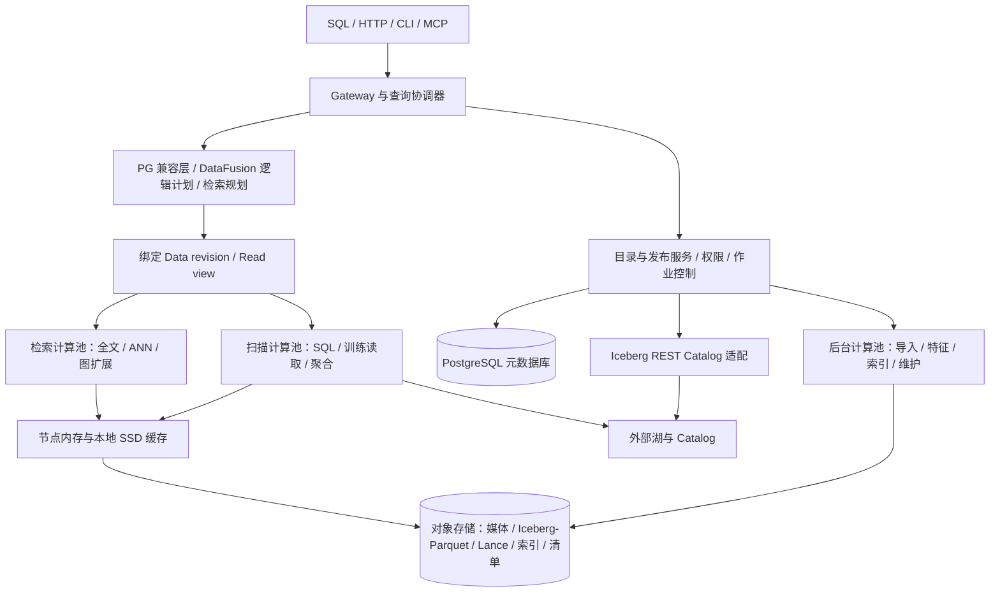

# GuraDB 技术架构 v0.6：技术参考

状态：概要设计的技术参考；长期推荐基线与当前实现分列。M0/M1 有界 alpha、部分 M2/本地 worker 及离线恢复已有历史证据，完整 M2/M3/M4 未完成。设计更新：2026-10-20；本轮不修改运行时。

完整设计入口为[概要设计v0.6](design/outline-design.md)，从S1–S5业务与[竞品证据](research/2026-10-20-outline-design-evidence.md)推导五类架构和横切质量；[模块合同](design/outline-module-contracts.md)规定松耦合边界，[运行治理专题](design/outline-runtime-and-operations.md)细化部署、性能、可观测性、云适配和安全合规。本文保留既有技术细节与兼容约束，新增组织原则见[ADR0018](decisions/0018-outline-design-and-module-contracts.md)，任务顺序以[并行实施计划](plans/2026-10-20-parallel-delivery.md)为准。

此前[方向复审](reviews/2026-10-19-product-direction.md)与[产品合同](product/product-contract.md)解释纠偏依据；历史代码/证据结论保留在[功能复审](reviews/2026-10-18-capability-architecture.md)。除现状说明外，统一计划、计算池、缓存、REST Catalog、HA 均是目标。

用户已确定采用对象存储湖架构，放弃高并发 OLTP，不支持实时延迟敏感事务，见 [ADR 0002](decisions/0002-object-store-lake-boundary.md)。本版依据[产品功能架构](product/functional-architecture.md)与[技术调研](research/README.md)，为后续详细设计选择默认路径；不再将所有技术选项并列悬置，也不把选型建议当作已经验证的功能。

## 0. 本轮纠正的系统边界

产品是可管理、查询、授权、部署和恢复的多模态数据库。Iceberg/Lance/Tantivy/DataFusion 是实现构件；它们的组合不自动得到数据库产品。既有目标方向保留，以下缺口成为主线，不能长期称为过渡状态而继续扩张模块。

| 责任面 | 产品目标与默认路径 | 当前必须收敛的缺口 |
| --- | --- | --- |
| 数据资源面 | 共同 dataset/schema、资产/片段/特征/关系模型；外部与托管接入有稳定入口 | 当前 record+vector+URI 不能表达完整对象/坐标/多特征；公开批量写与schema管理缺失 |
| 目录与治理面 | PG小型控制面是逻辑目录权威，统一revision/view/授权/job/pin；manifest作为不可变描述符 | Rust启动清单和Python/PG分别生成view和授权；不能靠手工pin/重启维持产品一致性 |
| 查询面 | SQL/HTTP/SDK/CLI/MCP进入共同语义与计划；关系、检索、图和训练选择复用算子合同 | SQL与search/graph/export分支独立；外观代理不足以完成统一 |
| 存储与索引面 | 对象湖事实唯一；媒体/特征持久，访问层可重建且绑定版本 | JSON BM25/Tantivy/全局和分片ANN重复产物需按成本收敛；不能变成第二主库 |
| 作业与运行面 | 接入/构建/维护/导出持久状态与对账；查询/后台资源隔离 | 全量rows协调器、本机路径、128 run生命周期，不满足规模与长期运行 |
| 产品交付面 | 可安装发行物、配置/能力发现、安全/观测/恢复与升级合同 | 源码脚本和局部验收尚不能代替产品安装、运维或生产发布 |

### 统一查询的验收边界

一次请求先解析身份与预算，向共同目录绑定不可变 `QueryContext`（此处是设计名，公开schema待定）：dataset及schema身份、revision/read view、源/索引清单、有效授权上下文、deadline/内存/I/O/候选预算与pin。之后才规划和执行；不能由协议或某一路算子重新取latest。

已有 Rust/DataFusion 是关系执行默认基础，检索/图以受约束节点或清晰的Arrow算子边界接入；Python可继续做控制/后台与生态适配。所有在线路径必须通过同一语义合同，不用语言统一冒充语义统一。SQL 与 HTTP 通过同一数据/模型/权限真值验收；训练选择复用这些语义，导出是独立消费方式。

### 迁移顺序与兼容

1. 先定义版本化对象/视图描述符及目录解析入口，令固定manifest成为一种登记来源；保留旧M0启动路径作为显式alpha兼容模式，不悄改历史ID。
2. I1先在受保护固定输入上让SQL provider和HTTP任务复用目录与查询上下文，统一已支持的过滤/投影、候选与回表；授权、pin、预算和发布fencing随共同读合同冻结。
3. I2在同一dataset上接入资产/片段/特征、受控导入与生命周期；I3再接样本选择所需受限关联/聚合与真实框架消费。每片用旧行为与独立真值对照，不要求SQL扫描与ANN排名返回同一列表。
4. 按需provider/流式批次、worker局部读取和有界归并在上述切片中逐步接入；去掉协调器全量rows并完成相关工作集大于缓存和冷热证据后，才进入真实多机规模验收。

任何持久描述符变化都需旧reader/writer窗口、在途job/pin、备份和新目录重建/向前恢复方案。旧M0/M1兼容路径在替代范围通过后才讨论弃用，不能删除负例或放宽上限让迁移变绿。

### 物理栈的保留与重评

对象存储/Iceberg-Parquet、Arrow/DataFusion、派生Lance与全文/边结构、PG控制面仍是候选默认基线，不因本轮调研整体换库。LanceEnterprise、Vespa或Milvus的服务架构不能当作免费可复用的开源组件。

每份重复数据/索引需登记所有者、输入/版本、完整性、空间/构建/请求成本、恢复方法与旧视图窗口。若不能证明Lance冗余或自定义BM25路径收益，应在固定质量/预算下评估替代并形成ADR；不能未经测量宣布哪种布局更快。原有[ADR 0003](decisions/0003-storage-and-execution-baseline.md)的重评条件继续有效。

### v0.6的规模与消费准入

[ADR0020](decisions/0020-product-review-and-vertical-delivery.md)将共同语义、按需读取与样本消费列为优先。P13在G1内分I1/I2/I3提前真实接线；CF1按A/B/C批次冻结，详见[实施计划](plans/2026-10-20-parallel-delivery.md)。保留Python后台/生态适配，不要求整体重写。

扩大规模前，查询不得依赖协调器持有全部业务rows或每次读取全部源/索引文件。固定snapshot provider向执行层准确声明谓词下推、列/行组裁剪及剩余过滤；候选有界、按稳定ID/version批回表，Arrow流式背压与内存/I/O核算贯穿。全局排序/关联等工作随支持算子独立验收，不能把数据量相关内存隐藏在native进程。

范围读取将固定对象版本、可信清单、完整性模式和缓存验证作为一体合同；整对象SHA-256不能证明任意局部字节。强局部完整性需已认证块摘要/证明或在预算内全对象验证，能力不足明确拒绝相应模式。详细机制与负例见[运行设计](design/outline-runtime-and-operations.md)。

[训练合同](product/training-contract.md)规定sample与record分离、成员/处理版本、组隔离和数据/顺序复现；框架消费状态与数据库查询任务状态分别维护。事实/向量/索引/媒体工作集分别测缓存，物化去留按同质量下的构建、回表、历史保留及恢复成本决定。

## 1. 架构结论

**对象存储持久层 + 开放事实表 + 可重建检索物化层 + 独立计算资源池 + 强一致的小型控制面。**

| 层次 | 推荐路线 | 接入阶段与边界 |
| --- | --- | --- |
| 业务持久层 | S3 API 对象存储；不可变数据与产物 | S3 兼容后端逐项认证，不依赖 rename 或目录 LIST 重建事务状态 |
| 开放表与托管写入 | Iceberg v2 + Parquet | M1 先接受限固定快照只读；M2 单表 append 独立验收，不以 reader 可用推导 writer 可用 |
| 多模态对象 | 大媒体外置，表内保存版本化引用与片段元数据 | 不将全部音视频塞进关系行，不默认全量解码 |
| AI 物化层 | 首选验证 Lance 数据集及 ANN，按源快照重建 | M2 ANN 独立门禁；不与 Iceberg 双主，外部 Lance reader 另行认证 |
| 查询基础 | Rust + Arrow + DataFusion | M0 单进程固定 manifest/Parquet 查询；检索扩展与 M3 分布式执行逐步接入 |
| 全文 / Graph | Tantivy 分片索引；边表 + 邻接物化 + 有界遍历 | M1 BM25；M2 有界 Graph 独立门禁；不自建完整搜索引擎或完整通用图数据库 |
| 控制面 | PostgreSQL 小型元数据库 + Iceberg REST Catalog 适配 | M0 固定清单无需可变 catalog；M1 起验证持久目录/作业/发布，不保存业务逐行数据 |
| 接口 | HTTP 查询/作业 + PostgreSQL 18 SQL 子集 + 有界 PG wire | M0 只读 HTTP；PG SQL 端口作为独立切片实施，语法、类型/函数与 wire 分开验收，不继承完整 PG 事务/扩展行为 |

上述选择与替代项见 [ADR 0003](decisions/0003-storage-and-execution-baseline.md)。依赖版本需要在联编和互操作 POC 后固定，不能单凭各组件独立可用就假定组合可用。

按[路线图](roadmap.md)逐切片接入：M0 固定清单扫描，M1 固定 Iceberg 快照与 BM25/精确向量融合，M2 分别验证 ANN、Graph、受限增量和单表写入，M3 真实多 worker，M4 发布验收。每个实验产出可复用内核代码；Lance、Graph、分布式和 writer 不是首个可运行服务的共同前置依赖。

## 2. 逻辑与部署架构

### 当前有界实现

| 路径 | 实际执行与存储 | 尚未跨越的边界 |
| --- | --- | --- |
| M0 SQL | Rust/Arrow/DataFusion，固定 Parquet manifest，全文件有界读取与 MemTable | 未统一接入 M1 PG read view；无通用 JOIN/聚合、流式 provider 或 spill |
| M1/M2 服务 | Python/PyArrow 编排及 scan/search/graph/export，PG 持久目录/作业/权限/pin | scan 仅 limit；训练全视图导出；不是统一 DataFusion 检索计划 |
| 全文/向量 | 旧 v1 Tantivy；新 v2 自定义全局统计 BM25/三份 JSON postings；精确 L2、Lance IVF_FLAT 与分片重排 | 当前同时保留多份索引产物，低 probe/冷热/规模成本未完整验收 |
| worker | 单机三个真实子进程，或 loopback HTTP 服务；物理 serving/BM25/ANN 分片 | 共享绝对路径；协调器仍全量载入 rows/校验全部产物；不是跨机分布式 |
| 同步/托管写 | 新源文件 append 增量、稳定版本继承，索引全重建；本机 SQLite catalog + PG 意图 + flock 的托管 append | writer 固定 schema/规模；无跨机源 fencing、Continuous 或公开写 API |
| 恢复 | 冻结服务/源写入后的本地 PG、对象、目录与 pin 联合备份恢复 | 不是 HA/PITR/异地 DR；恢复后需补撤权，完整 release 门禁仍缺 |

实际边界由[ADR 0011](decisions/0011-m1-bounded-snapshot-serving.md)、[ADR 0012](decisions/0012-bounded-p0-and-local-workers.md)与后续[ADR 0013](decisions/0013-local-p0-partitions-and-recovery.md)限定；后者推进了本地索引分片与恢复，不能把前一阶段的“ANN单节点”当当前唯一实现。

### PG SQL 端口增量

[ADR 0014](decisions/0014-bounded-pg-wire.md) 已将客户端 PostgreSQL 协议接入 Rust gateway，真实 psql/Psycopg 和 PG 组件子 driver 已本地通过；最终提交门禁以 task receipt 为准。当前范围和运行方式见 [PG 指南](design/pg-wire-running.md)。可选 `pg_listen` 与 HTTP 共享授权文件、单表只读规划、固定 manifest、查询执行与资源上限；它不是将客户端 SQL 代理到控制面 PostgreSQL。Describe 使用同一白名单规划获取类型，不预先扫描数据。

首片限制为 loopback、非 TLS、固定 `guradb` 数据库、`principal_id`/token 认证、simple/extended query 与 int8/text/bool/NULL。真实 psql/Psycopg 3 和负例独立验收；SDK 采用 autocommit。事务、系统目录、会话设置、COPY、扩展、统一检索 SQL 与跨机接入不由连接成功推导。无持久格式或控制面迁移；关闭新端口即可退回原有 HTTP 接入。

### 目标逻辑架构



目标部署包含可合并进程的四类逻辑角色：gateway/coordinator、catalog/job service、query worker、background worker，另依赖元数据库与对象存储。M0 从单进程扫描开始，不先拆服务；M3 才验收真实多 worker。检索和扫描可共用 worker 实现，通过资源池与配额隔离；大规模时分别部署。

不从第一版引入一组相互双写的独立全文、向量、图数据库。查询计划统一处理身份、过滤、快照和结果，专门库负责访问结构。

## 3. 数据模型与权威来源

| 逻辑对象 | 建议持久表达 | 关键约束 |
| --- | --- | --- |
| Record / Asset | Iceberg 事实表 + 原始对象引用，或注册的外部源 | `record_id` / `asset_id`、记录版本、租户/数据集、对象身份及校验 |
| Segment | 片段事实表 | 父资产版本、分块/抽帧规则、时间/页/空间坐标与单位 |
| Feature | 持久特征输出表/对象，绑定输入与模型版本 | embedding 空间、维度、距离/归一化约定，不能只依赖列名 |
| Relation | 带类型的边事实表 | 源/目标的带类型逻辑 ID、方向、属性、证据与版本 |
| Data revision | 不可变清单 + 目录指针 | 精确表快照、schema 与对象引用；不要求所有源同一原子时点 |
| Index artifact | 对象存储中的不可变索引/物化数据清单 | 源 revision、记录映射、配置、模型、分片、校验与构建状态 |
| Read view | 不可变发布清单 | 同一 data revision + 配套索引清单与可见性规则 |

Iceberg v2 的物理行位置不是 GuraDB 的永久记录 ID；Parquet 重写、Lance compaction 和分片迁移都必须通过逻辑 ID/版本映射。不得把某个库实验性的 stable row ID 当作跨格式身份契约。

身份命名空间、空/重复键、无稳定键外部源及跨表版本绑定遵循[数据与查询契约](product/data-contracts.md)。固定快照可读不等于拥有跨版本逐行增量身份。

原始媒体和关键特征是事实数据；索引、邻接缓存、向量物化列与统计是派生数据。特征生成成本高或输入/模型可能失效时，应保存特征输出，不能假定索引永远能重新调用模型生成。

外部数据保留其原生事实来源。注册一个 Lance 表或 Delta 表并不要求复制成 Iceberg；需要加速时才建立受版本约束的物化层。外部源的直接可读、导入、导出与原地写回是四种不同能力，见[格式矩阵](compatibility/lake-formats.md)。

## 4. 对象布局与缓存

建议按租户/数据集隔离命名空间，具体前缀可演进：

```text
assets/<asset-version>/...             原始媒体/文档/数组
warehouse/<table-id>/...               Iceberg 数据与表元数据
features/<job-id>/...                  需要持久保留的处理输出
materializations/<view-build-id>/...   Lance 等派生列式访问布局
indexes/<index-id>/<build-id>/...      全文/邻接等索引产物
revisions/<dataset-id>/<revision>/...  数据清单与已发布视图清单
results/<query-id>/...                 有保留期的查询/导出产物
```

表格式拥有自己的内部路径，GuraDB 不自行篡改其 manifest。清单较大时分片放在对象存储，元数据库保存引用和小规模状态，不保存每个候选或每条边。

内存保存热点元数据/小结构，本地 SSD 保存数据文件/范围、已下载索引和可丢弃缓存，对象存储保存持久数据和可恢复产物。索引副本放入 SSD 是缓存/预热策略，不是业务主副本协议。

通过列投影、文件/行组裁剪、请求合并、预取和批量读取控制远程访问。先支持下载完整不可变索引 shard 后本地打开，后续再验证按页/范围访问。检索延迟必须区分热、冷和部分命中；对象请求数量、下载量与缓存驱逐纳入成本。

对象身份记录后端、位置、不可变 key/对象版本及完整性摘要；ETag 不无条件等于内容摘要。摘要只能校验内容，不能找回被覆盖或删除的旧字节。可复现读取还需要版本可寻址和保留保护，具体等级见第 11 节。每个 S3 兼容后端单独验证读取、条件请求、multipart、版本、权限和失败语义。[S3 条件请求](https://docs.aws.amazon.com/AmazonS3/latest/userguide/conditional-requests.html)、[对象校验规则](https://docs.aws.amazon.com/AmazonS3/latest/userguide/checking-object-integrity-upload.html)、[S3 Versioning](https://docs.aws.amazon.com/AmazonS3/latest/userguide/Versioning.html)。

## 5. 写入、提交与发布

### 5.1 业务写入路径

M0/M1 不提供业务写入；M2 的首个 writer 切片仅支持 GuraDB 托管的单表 append/批量导入，并按表串行提交。持续微批、批式 UPDATE/DELETE/MERGE、外部原地写回及多表写作业分别后续设计，不能随 reader 或同步功能隐式加入。它们是批次提交或维护作业，不承担高并发点更新。

M1 的外部片段/特征接入是注册源列或不可变 Parquet/对象清单并绑定固定视图，派生索引与训练导出可写自身产物；这些不要求先实现托管 Iceberg 业务 writer。

1. 创建持久 job，校验授权、schema、输入版本、预算及去重规则；取得同表提交权，确认前序源提交已对账。
2. 并行生成不可变数据文件/媒体对象，校验后提交到相应表格式；未提交产物保持不可见。
3. 记录精确的表快照，生成 data revision 清单；通过目录 CAS 发布数据版本指针。
4. 以该 revision 构建/刷新索引，输出不可变 artifact 清单。
5. 检查配置要求的索引集、源版本、删除和权限规则，CAS 发布新的 read view。
6. 将旧版本按保留/pin 规则回收；失败对象通过对账和格式维护协议清理，已被源表提交引用的文件不能按未发布垃圾直接删除。

`data_committed` 与 `search_ready` 分别报告。导入或 SQL 写作业成功仅表示所声明的数据提交/发布已经完成，不能暗示所有索引同步完成。

### 5.2 原子性边界

单表提交遵循格式/catalog 协议；GuraDB 目录指针的切换提供 **GuraDB 读者的版本集合发布原子性**，不提供跨表业务写入事务。首个 writer 不接受多表原子写作业；外部加工的多表结果只能由上游完成清单或明确版本集合绑定。外部引擎绕过 GuraDB 目录时可能看到中间提交。本版不承诺跨外部湖、跨任意读者的全局事务，也不引入业务两阶段提交。

Iceberg REST Catalog 的多表提交是可选协议能力，不能作为所有后端的默认保证。[REST Catalog 协议](https://iceberg.apache.org/docs/latest/rest-protocol/)。发布清单不替代源格式协议，也不使对象存储自动获得跨对象事务。

每个发布使用预期旧版本和持久作业身份；worker 可重试执行，只有当前持有有效发布权的任务可提交。提交结果未知时先对账，不能盲目重复写入或覆盖后来版本。HTTP 通用幂等键仍需独立设计。

源 catalog 提交与 GuraDB 发布分别约束：worker 只生成不可变产物，源提交通过受控入口；后端缺少 fencing 时，不宣称已阻止所有失效任务生成孤立源快照。发布 CAS 还要检查固定目标 revision、任务 generation 与当前发布序，防止旧构建重新获取新指针后使视图倒退。细节见 [ADR 0004](decisions/0004-snapshot-and-index-publication.md)。

托管表不接受绕过受控入口的外部 writer。单表源提交结果未知或源已提交而 data revision 尚未对账时，阻止同表后续提交与依赖它的发布；先依据 job、精确快照和预期父版本确认结果。不得让下一次 append 自动基于未知 HEAD，把前次未确认内容带入新视图。源提交已确认、仅索引未就绪时可继续串行接受 append，索引按固定 revision 构建；取消索引作业不撤销事实提交。多表原子写入若后续确有需要，须单独设计隔离中间源提交与恢复协议。

### 5.3 湖加工结果同步与服务化

新增产品技术目标见[湖同步目标](product/lake-sync-and-serving.md)与 [ADR 0006](decisions/0006-lake-sync-and-serving.md)。`SyncDefinition` 描述源/目标、映射、刷新模式和索引就绪条件，`SyncRun` 固定一次执行的目标源版本；名称仍为领域模型，稳定接口待设计。

复用现有模块：connectors 发现源提交/变化，cluster 调度后台任务，storage 直接读取或接收不可变物化产物，index 维护全文/ANN/邻接，catalog 对账并发布 read view。此能力不预设新微服务或新事实主库。

M1 先完成受限 Iceberg 固定 Snapshot；M2 首条显式触发增量仅接受有已验证稳定键的 Iceberg append-only 历史链。更新、删除、压实、回滚、换分支和不兼容演进先明确拒绝，或按事先配置并披露的 Snapshot 重建策略执行；Continuous 后续独立门禁。后台直接生成目标格式/索引产物，遵循源/目标格式提交协议，不强制经逐行 SQL 导入。初始加载固定 V0，期间新变化从保留的源历史继续维护；不能混入不受控的“最新”。

同步分别保存 discovered、applied、逐索引 indexed、published 进度。持久应用确认后才能推进对应 checkpoint，read view 指针与 published 进度在同一控制面原子操作中切换；已消费或单路索引完成均不等于查询就绪。重试依据源事件身份、目标版本和 generation，结果未知先对账。

原始媒体可保持外部版本化引用，必要列/向量可物化；外部湖权威的同步表示禁止客户端独立修改。压实/物理重排不视作业务变更；首条增量路径遇到此类非 append 提交也须拒绝或 Snapshot 重建，不能仅把新增文件当新增记录。变化历史缺失必须停止/重建；跨源版本集合仍不代表全局事务时点。

## 6. 读取与索引一致性

本轮推荐的默认策略是 **读取已发布 read view**，接受可观察的索引滞后，避免旧候选与新数据回表混合。每个数据集配置其检索服务需要的索引集合；不需要检索索引的视图可直接引用 data revision。

| 读取方式 | 语义 | 超限/缺失行为 |
| --- | --- | --- |
| `published`（默认） | 查询开始绑定一个已发布视图，扫描、检索、图路径和分页均使用其中版本 | 超过允许新鲜度则明确失败或等待；不静默跳到不完整版本 |
| `data_committed`（显式选择） | 绑定已提交数据版本，以精确扫描/正确增量补偿满足查询，或等待对应索引 | 预算内不能保证完整则报错，不以旧索引冒充最新 |
| 显式 `read_view_id` | 训练与可复现任务 pin 一个已发布视图 | 源或视图已过期时明确失败，不自动替换为最新 |

这些是逻辑契约，参数命名与类型已保留在查询草案中，完整生命周期仍需详细设计。返回实际 data revision、read view、各源版本与索引版本；不存在单一跨源原子时点时直接披露版本集合。

默认查询从已发布 read view 绑定源版本，不再向源 catalog 重新解析“最新”。源发现属于刷新，显式 `data_committed` 也必须先固定目标 revision 再验证查询所需的完整覆盖。每个全文/向量/图 artifact 绑定源 revision、shard 集合、schema、模型/分析器/配置版本。复用旧索引必须能证明覆盖关系并应用正确的追加/更新/删除补偿，不能仅比较一个时间戳水位。

普通数据删除在新 revision 中生效，历史读取由保留策略控制；权限撤销与强制擦除另有访问门禁，不等待索引重建。候选、融合、图路径、回表和原始对象读取都须检查有效授权。授权无法确认时停止访问，不能以缓存或旧视图扩大权限。

撤权约束后续受控服务端访问，不能追回已交付字节或自动撤销上游签名 URL；需要严格撤权时经受控代理读取，直连访问另受源权限/有效期合同约束，见[数据合同](product/data-contracts.md)。

## 7. 查询执行与检索融合

PostgreSQL 兼容层负责支持范围、类型与错误映射，将查询交给 DataFusion 及扩展计划节点；共享 Arrow 批次表示。SQL parser 的 dialect 只能解决语法的一部分，不能替代 PG 函数、类型、系统目录、驱动或事务兼容，依据见[执行引擎调研](research/execution-and-ecosystem.md)。

查询路径为：身份/预算 → 绑定固定 read view → 关系/检索联合计划 → 分片执行 → 跨分片合并/去重 → 融合及图扩展 → 最终过滤/回表 → 有界结果与来源信息。

- 结构化路径：投影、谓词、分区/文件裁剪、连接/聚合，以及必要的残余过滤。
- 全文路径：Tantivy 负责分片内 BM25/文本检索；GuraDB 负责路由、全局统计或明确的分数近似、跨 shard 合并和发布。中文与多语言分析器独立配置与验收。
- 向量路径：精确 flat 扫描为正确性基线；首选验证 Lance IVF/PQ 路径及精确重排，HNSW 作为热点小分片候选。索引选型不是冷对象存储随机 I/O 性能保证。
- Graph 路径：事实边表 + 按源/目标分组的邻接访问结构，执行方向/属性过滤与有界多跳；限定扇出、边数、内存和时间，保留路径证据。首版不做全量 Cypher/GQL 或任意全图算法。
- 融合路径：首选 RRF，对稳定逻辑 ID 去重，使用明确的同分排序；不直接相加全文原始分数和向量距离。可插拔重排放在有界候选集之后。

过滤要尽可能进入候选生成；仅在 ANN 返回后过滤可能降低有效召回。每 shard 结果的全局合并需区分精确与 ANN，候选扩张、偏斜、过滤选择性和终止预算均需可观测。Graph 既可以约束候选，也可以扩展或解释候选，不固定在流水线末端。

完整算法与复用边界见[检索和图调研](research/search-and-graph.md)。这些库都不自动提供本项目的统一快照和分布式事务。

## 8. Lance 物化层的具体边界

从一个固定 data revision 物化必要的 `record_id`、`record_version`、embedding 和可安全下推的过滤列到独立 Lance dataset；构建索引并冻结 dataset version，将该版本加入 GuraDB read view。外层保存它到权威源记录的映射。

这会重复保存向量和部分列，但保留了“谁是事实来源”的单向关系。压缩/重排后重新验证映射；不把 Lance 的 index 文件直接嫁接到任意 Parquet row position。Lance 表/索引有自己的版本与 fragment 生命周期，需用整体 API 集成。[Lance 表规范](https://lance.org/format/table/)。

POC 必须测量：依赖联编、读取/过滤正确性、删除与 compaction、物化/构建时间、存储放大、随机回表 I/O、缓存不足时的质量/延迟。如果此路线不满足成本或可维护性，保留事实层，替换向量访问结构；不能让物化方案反过来制造两个独立主表。

## 9. 分布式运行时与资源管理

M3 首个分布式目标是受限任务/分片执行与确定性发布，不从头实现共识数据库；分布式 JOIN/聚合不作为首条多 worker 检索的前置条件。

- 扫描按固定快照中的文件/行组拆分，检索按独立索引 shard 路由；物理 worker 与数据身份解耦。
- coordinator 生成有版本的任务，worker 通过 Arrow 批次和显式 exchange 传输数据；Arrow Flight 等传输方案在 POC 中比较。
- 网络 shuffle、spill、分布式聚合/Top-K、重试、取消和内存核算是显式开发工作；DataFusion 单节点执行不自动具备这些能力。
- 调度利用缓存亲和性，但 worker 退出不能丢已确认业务数据。任务输出不可变，以 fencing/发布 CAS 阻止失效 worker 覆盖结果。
- 将交互检索、训练扫描、索引构建/压缩分成配额与队列；限制并发对象请求、内存、SSD、网络和图扩展。
- Ballista 作为 DataFusion 分布式参考/候选，先验证扩展计划、任务恢复和版本兼容，不预设可以零改造接管全部内核。

控制面 PostgreSQL 负责小规模目录事务、任务/租约、权限和发布指针，可使用成熟 HA 方案。是否复用某个 REST Catalog 服务通过独立适配层决定；不假设它和 GuraDB 元数据总能在一个数据库事务中提交。

## 10. 训练读取与处理作业

M1当前从固定revision/read view导出记录级manifest与split；M2/I3目标增加样本/成员与处理身份、分组隔离及一种真实框架的固定拓扑消费，验证样本字节和声明的顺序/批次复现。混洗、弹性分片和精确断点续读后续分别验收，详见[训练合同](product/training-contract.md)。

后续顺序训练优先批量扫描、Parquet 投影及经认证的 WebDataset 分片；随机/混洗读取验证 Lance 物化、预取和局部性。不要为了逐样本随机读取产生大量对象存储小请求。训练 manifest 不等于已经支持 WebDataset 导出、训练框架 sampler 或消费恢复，三者单独适配。

OCR、ASR、抽帧与 embedding 为可插拔后台作业，首版允许外部完成后导入。CPU/GPU/external worker 的资源和模型服务独立扩展；数据库不承担模型 serving 或训练调度。

## 11. 故障、维护与可观察性

| 故障/变化 | 设计要求 |
| --- | --- |
| worker 退出或任务重复 | 重试可重算阶段，隔离暂存结果，确保只有合法发布者能提交 |
| 对象存储限流/暂时失败 | 有预算的退避、背压与可诊断失败，不无限重试 |
| 表提交成功但目录未发布 | 按 job 和精确快照对账，保留旧 read view；禁止盲目重放 |
| 某一路索引构建失败 | 旧视图继续可用，新视图不部分发布；显式最新读取按预算等待/失败 |
| 元数据库故障 | 停止新写入/发布与无法完成授权的请求，按备份/日志恢复控制状态 |
| 外部 vacuum 或对象丢失 | 明确视图失效，不能重新规划成另一版本后冒充相同快照 |
| compaction/重平衡 | 新产物先完成并验证，再切换清单，旧产物满足 pin/保留后回收 |

保留能力随数据集登记，不把本地 pin 当成外部 vacuum 锁：

| 等级 | 必要条件 | 承诺 |
| --- | --- | --- |
| `upstream-protected` | 上游可执行的快照/对象保留保护，覆盖查询、构建及训练所需期限；按连接器认证保护与释放协议 | 在保护期限内保留固定版本；源端违约仍明确失败 |
| `managed-copy` | GuraDB 托管固定事实数据及其完整依赖闭包，包含所引用媒体、必要元数据/删除信息与不可重建特征 | 可由本地保留与 GC 协议保护；只复制向量或部分列不属于此等级 |
| `best-effort` | 只有可寻址版本/摘要，无法约束上游过期、覆盖或清理 | 允许受限查询；不得承诺长期复现，失效时明确失败或事先转为托管副本 |

托管 GC 仅选择未被当前发布指针引用的旧 revision，先在目录事务中标记为 `retiring`，与新 query/train/build pin 的获取互斥；此后拒绝新 pin，等待已有 pin、保留期及安全期结束，再经各格式维护 API 回收。清理前后重试均检查源格式引用和所有权，不直接删除源元数据仍引用的对象，也不清理不受本项目控制的外部源。新构建在读取或复用旧产物前先取得 pin。外部保护必须通过上游协议取得，本地登记不产生这种能力。[Iceberg 维护说明](https://iceberg.apache.org/docs/latest/maintenance/)

派生索引可重建不代表重建耗时可以忽略；恢复目标要包含重建/预热成本。元数据库备份、对象存储策略与源 catalog 保留必须共同演练。

从第一条链路记录查询/作业 ID、输入/输出版本、索引新鲜度、候选数量、扫描与下载字节、对象请求、缓存命中、队列等待、取消和失败原因。性能报告同时包含训练吞吐、检索质量、冷热延迟与成本。

## 12. 模块落位与下一步

原有 [modules](../modules/README.md) 保留，新增职责通过模块内部子组件表达：gateway 增加 PG 兼容/结果接口；query 增加 DataFusion 扩展与融合；catalog 增加 revision/read view 发布；storage 管理对象/缓存；index 管理 Lance/Tantivy/邻接产物；cluster 管理任务与资源池；connectors 隔离各格式与 catalog。

下一步以共同对象/目录/查询语义和可操作的多模态检索闭环为主线，吸收原A1样本选择、A2按需读取、A3生命周期工作。先冻结合同，再模块并行与逐波真实集成，以相同质量/成本证据推进规模；不以全Rust重写或新增算法替代产品交付。见[并行实施计划](plans/2026-10-20-parallel-delivery.md)；真实分布式和生产仍分别在M3/M4验收。
