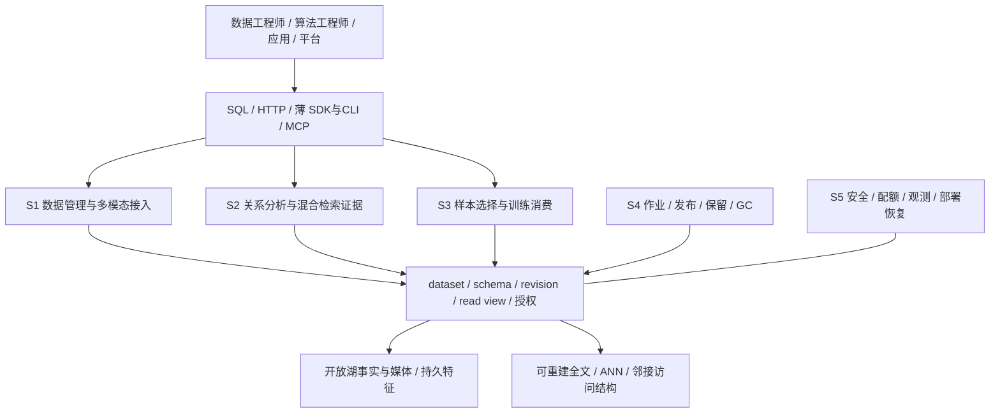
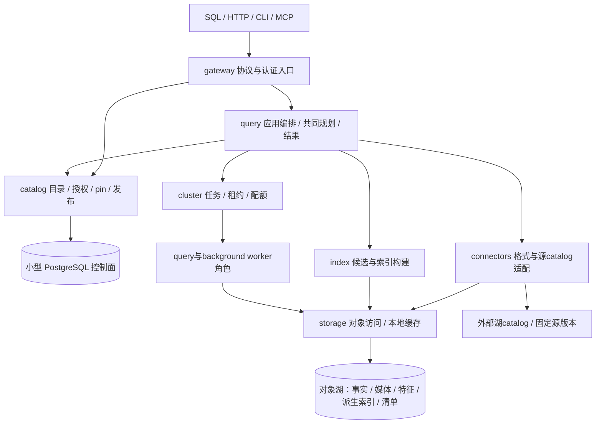
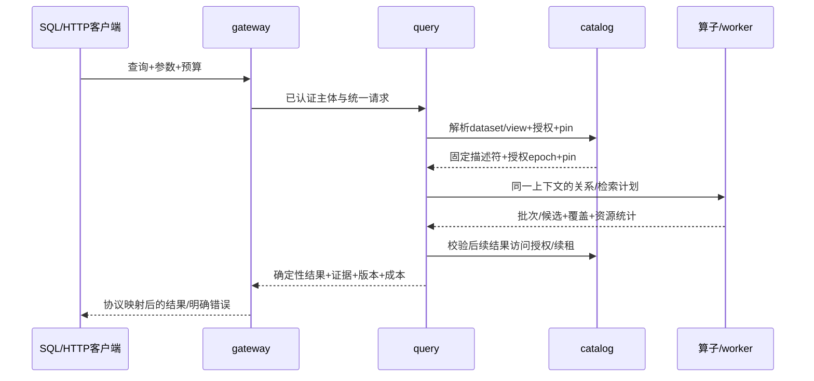

# GuraDB 概要设计 v0.6

日期：2026-10-20。状态：**供后续详细设计与实施的目标基线**；模块组织原则见 [ADR 0018](../decisions/0018-outline-design-and-module-contracts.md)，组件选择仍遵守 ADR 0003 的 POC 门槛。本轮只细化文档，没有新增数据库能力。

本文回答为什么建设、提供什么、如何拆分和如何验证；不替代版本化 API/schema、逐算子详细设计和发布验收。当前状态以[用户能力白名单](../user/features.md)、源码及绑定当前 commit 的报告为准，不能从本文目标推导支持。

本次v0.6落实产品技术评审：[ADR0020](../decisions/0020-product-review-and-vertical-delivery.md)接受图文检索到训练样板、分批合同与提前集成原则；[训练合同](../product/training-contract.md)补足样本/采样/复现边界。技术基线和长期目标保留，当前alpha白名单不变，新增能力均待实施。

## 1. 设计基线与阅读路径

| 部分 | 本文位置 / 专题 | 应得到的结论 |
| --- | --- | --- |
| 业务场景分析 | §2–3 | 用户、数据流、价值、边界、负载及独立验收 |
| 功能架构 | §4 | 场景到 12 能力域、产品对象和优先级 |
| 技术架构与关键技术 | §5–8 | 事实/控制/执行面、完整路径、组件选择与替代条件 |
| 模块架构 | §9 与[模块合同](outline-module-contracts.md) | 单向 DAG、唯一所有者、版本化端口、错误/预算与隔离开发 |
| 部署架构 | §10 与[运行治理专题](outline-runtime-and-operations.md) §1 | 单机、多机、可用区/故障域及升级恢复 |
| 性能实现 / 可观测性 / 云适配 / 安全合规 | §11 与[运行治理专题](outline-runtime-and-operations.md) | 每项的场景/竞品依据、目标、方案、预算、负例及证据 |
| 实施分解 | §12 与[并行实施计划](../plans/2026-10-20-parallel-delivery.md) | 工作包、冻结点、依赖、波次、估算和集成门槛 |

产品目标来自[产品合同](../product/product-contract.md)的 J1–J6；[路线图](../roadmap.md)仍是 M0–M4 范围唯一来源。官方事实、版别和设计推论集中在[本轮证据矩阵](../research/2026-10-20-outline-design-evidence.md)，历史深度比较见[八产品调研](../research/2026-10-19-database-products.md)。所有竞品资料是文档研究，未安装竞品、未做性能对跑；动态页面实施前需固定版本再核验。

### 现状与差距

v0.5历史源码基点为 `fe0a70c`；v0.6评审抽查基点为 `79e4d00`。现有 M0 Rust/Arrow/DataFusion 单表只读 SQL/HTTP 及本机 PG wire；M1/M2 Python/PyArrow 的快照、检索、训练、PG 控制面，以及本地三 worker/离线恢复是历史有界实现。两条查询路径尚未共享完整目录/计划，协调器全量 rows、共享绝对路径、重复索引产物与有限生命周期仍需收敛，见[现状复审](../reviews/2026-10-19-product-direction.md)。本轮未重跑数据库运行时测试，历史报告不能作为 v0.6 的新增能力证据。

## 2. 业务问题与产品边界

目标用户是数据工程师、算法工程师、AI 应用开发者和平台运维人员。今天应用往往分别接湖 SQL、向量库、搜索服务和训练文件；每个系统对 ID、删除、权限和最新版本各有解释。GuraDB 要验证的产品假设是：**一个逻辑数据集，在共同版本与权限下完成接入、分析、检索证据和训练消费，可以降低应用的版本对账与重复治理成本。** 尚无客户样本或市场证据，不能称为已证明的竞争优势。

竞品说明单点能力不足以构成差异：LanceDB 覆盖多模态与混合检索，Milvus 可服务外部湖数据，Vespa 组合检索与排序，Qdrant/Weaviate 提供向量产品的治理和运行路径。由此选择贯通工作流和可解释一致性作为验证对象，避免只增加算法数量。具体事实及 edition 限制见[证据矩阵](../research/2026-10-20-outline-design-evidence.md)。

| 业务责任 | 设计范围 | 明确拒绝 / 后续独立立项 |
| --- | --- | --- |
| AI 数据准备与版本化资产 | 外部湖固定版本、托管批量接入、资产/片段/特征/关系和 SQL 准备 | 高并发点事务、账务/订单 OLTP、任意外部写回 |
| 推理和 Agent 数据访问 | 有预算的交互检索、关联证据、授权媒体片段访问 | GPU 模型 serving、硬实时提交或同步写后所有索引立即可查 |
| 训练数据消费 | 同视图选择/对齐/split/manifest/读取及 pin | 训练调度、优化器、框架 exactly-once 消费保证 |
| 数据库运行 | 单机预览到真实多机，配额、观测、备份、升级与隔离 | 未认证多云、跨地域主动双写、未经演练的 HA/合规认证 |

首个垂直样本选择文本+图像，覆盖已有结构化/向量基础和媒体坐标。音频/视频的对象与时间片段沿同一模型逐模态验收；内建 OCR/ASR/codec 属于独立处理能力。没有业务数据时先用可分发样本与固定 synthetic 对照，禁止把 synthetic 规模或质量外推为产品基线。

## 3. 场景分析与可观察验收

### 3.0 用具体业务样板验证需求

以下是设计用例，不是已取得的客户需求；数据来源/许可与规模须在P00冻结。首个样板同时覆盖检索和训练，避免分别搭两个演示。

| 业务样板 / 优先级 | 数据、典型问题与流程 | 由业务推导的设计要求 | 价值假设如何验证 |
| --- | --- | --- | --- |
| B1 企业图文知识库 / 首个垂直闭环 | 产品手册文本/页图、图中区域、型号/版本/标签和引用关系；用户查某型号故障说明，文本与图像召回后沿关系定位对应版本证据 | asset/segment父版本、页/区域坐标、多特征空间、租户/文档范围过滤、全文/向量/关系共同view；旧手册与新图不能混配 | 独立标注相关文档/区域/关系真值，测试同义词/图像查询/过滤后空结果/跨租户；应用无需自行拼接多个数据库的ID与版本 |
| B2 同一语料的训练与评估集 / 紧随B1 | 选出带审核标签的图文对，按文档族或来源分组split，保存训练/评估集合；后续知识库更新后仍可重放原样本 | SQL受限关联/聚合、样本与模态对齐、分组防泄漏、模型/处理版本、媒体依赖闭包和持久pin | 独立reader逐值核对；组间无重叠、覆盖/重复可计算；发布新view不改变原训练manifest；不把随机seed等同无泄漏保证 |
| B3 音视频资料检索与数据准备 / 后续逐模态 | 音视频对象、外部ASR/抽帧/事件标签；按时间片段查证据，选择同时间对齐的帧/语音 | 显式时间单位/区间边界、父媒体版本、外部处理血缘、范围/批量读取；内建codec/ASR另立项 | 先验证外部预处理结果和片段对齐，再逐codec/格式验收；未测模态/解码不纳入首个闭环或支持声明 |

B1/B2的默认路径只需预生成特征与片段，不要求先实现模型平台。B2的分组split/去重必须作为独立选择规则设计、冻结并验证；现有alpha的seed+比例不能推出这项能力。若用户样本表明主要价值来自另一行业，重选业务fixture与预算，固定视图/权限等不变量继续保留。

### 3.0.1 首批验收的收敛

B1+B2贯通为一个图文知识库→证据检索→embedding/reranker训练与评估样板。P01先冻结语言/模型/维数/预处理、数据许可、独立相关性和样本/组真值、更新频率与预算；中文需求必须实际验收中文，不能由ASCII fixture替代。真实客户样本仍未取得，设计fixture与客户价值证据分开。

对照一套选定现有组合方案，以同源、同质量、同权限/保留要求比较接入、同步/对账代码和维护步骤、更新与训练追溯时间、查询/构建/存储成本；记录责任差异与失败，不以功能数量证明竞争力。方案/版本和评估窗口在P01冻结，首轮测量后由场景owner重评收益。

训练sample有独立身份与成员角色/版本；分组映射在分块/增强前确定并持久化。导出集合完整性、消费采样策略及模型结果复现分别验收；至少一种真实框架消费纳入G1，完整合同见[训练专题](../product/training-contract.md)。

### 3.1 场景矩阵

| 场景 / 旅程 / 角色 | 输入与操作 | 用户需要的结果 | 失败/约束与衡量方式 |
| --- | --- | --- | --- |
| S1 数据进入数据库 / J1 / 数据工程师 | 注册 Iceberg 固定快照，或批量接入图文、外部片段和 embedding；声明键、schema、模型及保留等级 | 一个 dataset 下能查看对象/schema、作业、data revision 与检索就绪状态 | 重复/空键、非法父版本/坐标/维度、未支持删除必须拒绝；逐值独立 reader 对照，计吞吐/失败率/请求与空间成本 |
| S2 多模态 RAG 与关系证据 / J2+J3 / 应用开发者 | 固定 view 上按租户/标签过滤，全文+向量融合，受限边关联，定位原文页或图像区域 | SQL/HTTP 对同一语义返回相同 ID/version、证据、实际视图和近似说明 | 旧索引/缺分片不得静默成功；计质量、过滤后 recall、冷热 p95/p99、回表成本与取消时间 |
| S3 样本准备与复现 / J4 / 算法工程师 | 关联标签、筛选投影、去重规则、确定性 split，生成并实际读取训练 manifest | 样本身份/模态对齐/来源/处理版本可核对，新数据发布不改变该训练集 | 模型空间混用、缺媒体、上游过期、pin不足、撤权不能隐瞒；计导出集合覆盖/重复/字节一致性、按策略消费次数与训练吞吐 |
| S4 增量和生命周期 / J5 / 数据工程师与管理员 | append 触发刷新，索引重建/补偿，发布新 view，保留/退役旧版本 | 数据已提交与检索就绪分别可见，未知提交有对账状态，旧任务不倒退发布 | 更新/delete/rewrite不能伪装append；源fencing、发布fencing、pin/GC竞争分别故障注入，计滞后/构建放大/恢复时间 |
| S5 团队部署与治理 / J6 / 平台人员 | 安装、授权、配额、诊断、扩容、备份恢复和升级 | 固定部署档位能按手册复现，失效授权不被旧view/缓存/媒体入口绕过 | 控制面断联、worker/区故障、密钥失效、地域违规和审计丢失有明确处置；按部署模式测恢复目标和资源成本 |

S1–S5 是同一数据库的不同任务，不是五套独立产品。S1 固定对象与版本，S2/S3 复用同一绑定，S4 产生后继视图，S5 约束每次访问。查询“最新”不是重新读取每个组件的最新值；默认只解析一次已发布视图。

### 3.2 调研如何转为目标

| 场景依据 | 竞品观察入口 | 本项目设计目标 / 取舍 | 可以推翻方案的证据 |
| --- | --- | --- | --- |
| S1：外部湖与自有数据并存 | Milvus 外部集合、LanceDB 表/版本 | 区分原生读取与托管副本；固定源版本，单一事实权威 | 格式认证或媒体依赖闭包不能成立时拒绝接入/降为best-effort，不能仅复制向量后承诺托管复现 |
| S2：检索需过滤和证据 | Qdrant Query API、Vespa 分阶段检索、LanceDB 混合查询 | 统一计划内做候选、融合、回表与有界关系扩展，保留近似信息 | 统一算子成本超过收益时重评布局/进程边界，仍保留共同语义，不能退回多套客户端过滤 |
| S3：相同样本与实际消费 | LanceDB 多模态/版本、PG 关系操作 | 关系选择产生固定样本合同，训练仅为另一种消费 | 顺序/随机读取实测不能满足预算时评估物化或导出布局，不能改变样本集合换吞吐 |
| S4：写入不等于可检索 | Milvus 外部刷新、Qdrant 写入确认、LanceDB 索引覆盖 | 数据提交、索引覆盖与发布状态分离；幂等不代替未知结果对账 | 后端缺源fencing时限制单受控提交者或拒绝托管写；目录CAS不伪装源事务 |
| S5：服务需要可运营 | Weaviate 备份范围、ClickHouse query_log、PG 恢复 | 从首片提供真实指标/权限/联合恢复合同，生产验收后置 | 缺恢复、升级、安全或云认证证据时保留预览，不能由worker数/覆盖率判生产 |

### 3.3 工作负载冻结

每条 S 场景建立数据 manifest、来源/许可、seed、schema、模型/分析器、键/删除/空值/偏斜/过滤选择性与独立真值。输入至少包含正常、空结果、恶意/错误和资源超限四组；检索、训练、接入在混合负载中共同运行。用户业务样本到位后按相同合同追加，不能覆盖 synthetic 历史结果。

数值 SLO 由测量和容量预算确定，流程与提案档位见[运行治理专题](outline-runtime-and-operations.md)。在确认资源、冷热、并发与质量前不承诺 QPS/PB/固定 p99；取消、候选、扫描字节等硬上限先作为保护预算冻结，超限明确失败。

## 4. 功能架构

| 功能域 | 场景驱动与竞品依据 | v0.6 设计目标和首个交付 | 对应实现边界 |
| --- | --- | --- | --- |
| F01 目录 | S1–S5，PG目录/竞品集合管理 | 共同dataset/schema/view/授权解析；先统一绑定 | catalog，其他模块不得私自生成产品view |
| F02 湖/对象接入 | S1/S3，Milvus外部湖 | 固定Iceberg白名单与对象身份，native/read/copy/write分开认证 | connectors解释格式，storage访问字节 |
| F03 多模态资产 | S1/S2/S3，LanceDB多模态 | 文本/图像asset→segment→feature及relation可操作，父版本/坐标可校验 | common值合同；catalog元数据；connectors导入校验 |
| F04 数据变更/同步 | S1/S4，外部刷新与写确认 | 受控单表append、显式源增量，未知结果可对账 | query应用编排，catalog状态，connectors源提交 |
| F05 关系分析 | S2/S3，PG/ClickHouse SQL | 过滤投影、受限标签关联/基础聚合与固定view选择 | query逐算子扩展；不从PG连接成功推导SQL全兼容 |
| F06 全文 | S2，Vespa/LanceDB全文 | 固定分析器与统计范围的BM25，返回片段证据 | index产物/局部候选；query全局排序 |
| F07 向量 | S2，Qdrant/LanceDB | 精确基线→受过滤ANN/重排，空间和质量可解释 | index映射/算法；query预算与完整性 |
| F08 Graph | S2，关系证据需求与Vespa组合借鉴 | 类型边、一跳/受限扩展与路径，不承诺通用图语言 | index邻接；query有界关联与跨片归并 |
| F09 混合检索 | S2，Qdrant Query API/Vespa/LanceDB | 共享谓词/视图/授权，RRF与确定性同分排序 | query拥有联合计划；协议仅映射请求 |
| F10 训练 | S3，LanceDB版本/PG选择 | 同语义选样、split、manifest和Parquet逐值消费 | query拥有选择与导出；cluster调度；catalog pin |
| F11 处理/索引作业 | S1/S4，Milvus分工/后台构建 | 持久Job、版本化产物、可重试构建与发布 | cluster执行租约，index构建，catalog发布；外部特征优先 |
| F12 治理运行 | S5及所有场景，PG/ClickHouse/Weaviate | 权限、预算、指标、备份/升级；生产逐部署验收 | 横切合同，唯一权威和责任见模块专题 |

以上是对[十二能力域](../product/functional-architecture.md)的设计细化，不新增“已支持”标记。最小单机成果仍先贯通 S1/S2 并留出 S3 同视图消费，随后完成 S3/S4；S5 从合同和单机运行开始贯穿，HA/多云分别后验收。

## 5. 技术架构与权威边界

图中为调用与数据流，不代表每框独立微服务；编译依赖必须遵守[机器 DAG](../../harness/architecture.toml)。common 只定义低层值和端口，不能反向引用服务实现；query 负责应用组合，catalog 不调用上层 query/index/cluster。worker 复用已验证模块，不创建第二套查询语义。

| 平面 | 权威数据 / 责任 | 禁止越界 |
| --- | --- | --- |
| 事实数据面 | 源表快照、原始媒体、不可重建特征；每个dataset有唯一写入权威 | 索引、缓存、训练导出不得升级为未声明的第二主表 |
| 控制面 | PG中dataset/schema身份、授权epoch、作业意图、pin和发布指针；对象存储保存不可变大清单 | 不把每条业务记录/边/候选塞PG；不把外部catalog事务等同PG本地事务 |
| 查询执行面 | 固定上下文内关系与检索算子、资源核算和有界结果 | 各路不得重新取latest、私自放宽授权/预算或吞掉缺片 |
| 派生访问面 | 绑定源revision的Lance/全文/邻接/统计，可重建可认证 | 不能独立接受业务写入，不能混用不同revision的候选 |
| 运维面 | 发布物、配置、审计、可观测性和恢复清单 | 观测日志不替代目录状态；备份恢复不默认撤销外部副作用 |

### 关键技术的选择与反证

| 决策 / 场景与依据 | 默认方案与原因 | 代价、替代与POC出口 |
| --- | --- | --- |
| 开放事实 / S1/S3/S4，Milvus外部湖与Iceberg规范 | 托管Iceberg v2/Parquet，外部原生读取，媒体外置；快照与批量扫描自然对应 | 删除/schema/源catalog逐项认证；若互操作不可保证则限制白名单，不自行拼文件忽略删除 |
| 共同执行 / S2/S3，PG关系准备与Vespa组合 | Rust/Arrow/DataFusion，自定义检索节点和TableProvider；Python保留后台适配 | DataFusion提供扩展点但不是完整数据库；若FFI/IPC过贵重评边界，先测算子和取消，不整库重写 |
| 检索布局 / S2，LanceDB混合检索与Qdrant过滤 | 精确基线，Lance派生向量/必要列；全文首选Tantivy；边表+有界邻接 | 重复存储/构建和随机回表成本需登记；现有BM25多份路径以真值/统计/成本决定收敛，保留兼容窗口 |
| 发布目录 / S4，竞品写确认/索引覆盖差异 | 小型PG事务、不可变revision/view、CAS+epoch/generation | 外部源提交分离，未知结果对账；不自研共识，不承诺跨源2PC |
| 分布式 / S2/S3/S5，Milvus分工与Vespa部署 | 固定分片任务、Arrow批次、配额；评估Ballista构件，替代为受限运行时 | 自定义节点、序列化、exchange/恢复必须实测；不因单节点DataFusion而宣称MPP |

技术规范补充：[DataFusion 扩展与对象访问](https://datafusion.apache.org/user-guide/introduction.html)、[Iceberg 版本/快照/删除规范](https://iceberg.apache.org/spec/)。规范的新版本能力不自动进入本项目v2白名单，也不触发依赖升级。

## 6. 对象、版本与生命周期

逻辑关系为 `Dataset → SchemaVersion → DataRevision → ReadView`；revision 固定多表/对象的版本集合，不意味着跨源同一原子时点。`Asset(version) → Segment(parent_version, coordinates) → Feature(input_versions, model_space)`；`Relation` 指向带类型 ID 和有效版本，保留证据。训练 manifest 再引用固定view、样本ID、split和模态对齐。

稳定逻辑 ID 不依赖 Parquet 行号、Lance rowid 或分片。特征空间包含模型/提取器版本、维度、距离和归一化合同；同列名不代表可比较。普通数据删除按revision生效；撤权和强制擦除经独立访问门禁，旧view/pin不授予永久访问权。

对象清单记录后端/地域、不可变key或版本、摘要与保留等级；ETag不能无条件当内容摘要。`managed-copy` 必须保留事实/媒体/删除信息和必要特征的完整依赖闭包；`upstream-protected` 需取得上游可执行保护；`best-effort` 不承诺长期复现。详情沿用[数据合同](../product/data-contracts.md)。

状态按不同轴建模：源提交 `prepared → committing → committed`，结果未知进入 `outcome_unknown/reconciling`，只有证明不存在且不会晚到的提交才可 `aborted`；索引 `queued → building → verified / failed`；视图 `candidate → published → retiring → collected`。未知结果阻断同表后续提交直至对账；索引失败保留旧合法view。取消后台构建不撤销已提交事实；回滚视图也产生新的发布epoch。这些是领域阶段，稳定枚举在P00冻结，语义以[模块状态合同](outline-module-contracts.md)为准。

GC由catalog先以事务令对象进入retiring并拒绝新pin，再等已有query/train/build pin、保留/安全期和源引用释放；storage只执行已授权删除，外部所有者对象不擅自回收。保留锁/法定留存与删除请求冲突进入管理流程，不能静默承诺物理清除。

## 7. 查询、检索与训练路径

1. HTTP/PG映射成同一语义请求；认证在入口完成，有效授权与dataset/view绑定由目录解析，预算只能向下收紧。
2. 规划固定源provider、谓词/投影及必要关联。结构化过滤尽早下推；不支持的谓词保留残余过滤。禁止对 ANN Top-K 后简单过滤就声称完整的过滤Top-K。
3. index返回带稳定ID/version的候选、分数语义、覆盖和近似信息；query负责跨片去重/全局统计、确定性排序、RRF及最终回表。缺索引按声明的完整补偿/等待/报错策略处理，不静默少读。
4. 图扩展使用同view关系事实、方向/类型及跳数/扇出/边数预算，返回路径证据；超过预算按合同报错，若未来允许近似截断须用户显式选择。
5. Arrow批次通过背压消费；取消、deadline、内存/I/O/候选额度贯穿远端与后台。分页/结果句柄绑定view和主体，续取时检查当前授权与有效pin。
6. 训练选择复用已支持关系语义，manifest记录选择/处理计划、样本成员版本、group/split及消费策略和依赖闭包，独立reader与真实框架逐值/轨迹验证；输出完成后再发布manifest，不能返回半成品成功。

SQL扩展语法、资源API/DDL、Arrow对外流式接口与训练框架适配需在对应工作包冻结稳定schema；此处领域名不是可直接调用的新API。PG18语法/类型、wire、目录、事务、扩展仍分别验收。

## 8. 接入、构建与发布路径

1. 接入请求创建持久Job/Operation，固定输入schema/键/模型、幂等范围、授权和预算；外部注册不得暗中改变源写入权威。
2. connectors读取已冻结快照或生成托管单表append文件；storage上传不可变产物，cluster调度执行，worker不自行切换产品指针。
3. query的应用编排通过源提交端口完成受控提交；connector校验预期父版本和提交权。响应丢失转unknown并对账，不能重试同一逻辑append生成两份事实。
4. catalog接受已验证源版本，发布data revision；index在该固定revision构建产物，校验ID映射、删除、模型/统计、shard集合和checksum。
5. catalog单独校验目标revision、索引要求、预期旧指针、generation和发布权，再CAS发布read view。源fencing和这里的发布fencing分别测试；旧任务不能读新指针后倒退发布。
6. 旧视图继续服务其合法pin；新查询只取已发布视图。授权撤销不等待新索引；清理和恢复按各自持久协议执行。

从单表append扩到update/delete/merge、Continuous或多表原子写均需新设计，不由状态机名称隐含支持。上游多表结果以明确版本集合或完成清单绑定；GuraDB view原子切换只约束GuraDB读者。

## 9. 模块架构与松耦合约束

基于S1/S4需要可对账控制，S2/S3需要共同语义，且Milvus的职责分工、Vespa的组合执行不等于必须复制其进程数，选择**模块端口先行、部署按需拆分**。详见[模块合同](outline-module-contracts.md)。

每个模块有唯一数据/副作用所有者；跨模块传版本化不可变描述符、Arrow批次和显式端口，禁止读写对方私有表/目录。持久状态、任务租约和发布权不是同一个概念。异步通知仅为提示，状态真值从目录/源catalog对账恢复。

按CF1-A共同读、CF1-B接入生命周期、CF1-C训练消费分批冻结，每批先于相应生产实现：字段语义、错误/幂等、预算/取消、生命周期、版本协商、兼容窗口及正常/故障fixtures成套审查。common仅容纳稳定值和必要port，业务编排仍归query；不能创建common万能层消除编译依赖后留下运行时循环。

单模块可用端口fake做状态机和负例，但不据此标跨模块成功。每个工作包须在真实peer和对象/PG后端上完成合同一致性验证，集成波次再验用户旅程；独立worktree只解决文件冲突，不能替代语义冻结。

## 10. 部署架构

S5的单机评估要求可安装和可恢复；S2/S3的混合负载要求分池；S4要求控制面与源提交的故障域明确。竞品依据为Milvus存储/计算角色、Vespa自托管与Cloud分工、Weaviate备份及PG恢复责任。具体拓扑、端口、信任边界和运行模式见[部署专题](outline-runtime-and-operations.md)。

目标分三档：单机产品预览合并逻辑角色；M3同地域真实多机将gateway/coordinator、catalog服务、query/background池及PG/对象存储分离；M4对实际宣称的HA模式进行故障/升级/联合恢复验收。计算副本的本地SSD是可丢缓存，业务事实不以worker本地目录为权威。

初期按同地域部署和单写控制面降低故障模型；跨区网络、对象请求/出口、元数据库HA和缓存预热单独计成本。跨地域采用有明确一致恢复点的备份恢复目标；主动双写和无证据RPO=0不在默认方案。

## 11. 横切质量设计

以下不是尾部运维附录：它们进入模块合同和每项实施验收，完整细节见[运行治理专题](outline-runtime-and-operations.md)。

| 专题 | 场景与竞品证据如何确定目标 | 默认方案 / 验收原则 |
| --- | --- | --- |
| 性能实现 | S2交互与S3顺序/随机访问冲突；Qdrant过滤、Vespa分阶段排序、LanceDB索引覆盖提示不能仅测热Top-K | 按需provider/投影裁剪、批量回表、流式批次/背压、有限候选/局部重排、分池调度和版本化缓存；测大于总缓存、冷热/部分命中、质量/请求/字节/内存/构建空间及混合负载 |
| 可观测性 | S4需要解释四类进度，S5需要诊断；ClickHouse query_log/竞品指标体现操作证据的重要性 | query/job/trace关联，operator/shard/对象I/O、排队与覆盖/新鲜度指标；授权/发布/GC审计；高基数身份不作为metric标签，故障演练验证告警和定位 |
| 云厂商适配 | S1固定对象身份、S3保留、S4条件提交；云API与身份不等价，竞品部署矩阵也区分产品形态 | storage做CloudAdapter，connectors做湖catalog；AWS/Azure/GCP/阿里/腾讯按版本/条件读写/Range/KMS/身份/保留/私网认证；缺能力拒绝相应模式，不用S3-compatible一词宣称全支持 |
| 安全 | S2证据与S3旧pin可泄露数据；Qdrant/Weaviate安全能力有edition边界 | 多租户资源命名空间、认证/授权epoch、服务间身份/TLS、最小权限短期凭证、受控媒体代理、缓存/候选/回表全路径撤权；无法验证授权时停止访问 |
| 合规与供应链 | S3复现留存和S4擦除存在冲突；PG/Weaviate恢复提醒备份范围必须显式 | 分类/地域/用途/保留与删除清单，legal hold审批、备份恢复后补撤权/擦除，日志脱敏、SBOM/许可证/漏洞与依赖固定；逐部署提供控制证据，不声明法务结论或认证 |

## 12. 实施与验收

[并行实施计划](../plans/2026-10-20-parallel-delivery.md)给出分批合同、模块工作包和四槽位协作。P13从早期参与：I1共同视图查询、I2图文接入/证据/更新、I3训练消费是G1内的真实集成检查点，不等待全部模块完成才第一次联测。依赖按“合同可开始”和“真实实现可集成”两层表达：冻结描述符后storage/catalog/index/connectors可独立开发；共同查询贯通和发布/GC故障验证仍有必要串行屏障。集成不留到所有模块完成之后。

代码修改前先补对应用户手册场景与正负例，模块完成需真实合同一致性证据，产品完成需S1–S5相应旅程，M3/M4仍按路线图退出。docs通过、stub通过、组件通过和产品发布是四种不同结论。

后续详细设计至少冻结：对象/API与错误schema、QueryContext与授权续检、源提交/目录发布协议、Arrow/exchange与资源核算、索引映射/统计、pin/保留/GC、云认证和安装升级恢复。未闭合项纳入计划风险与重评节点，不能在实现时由各模块自行补语义。
