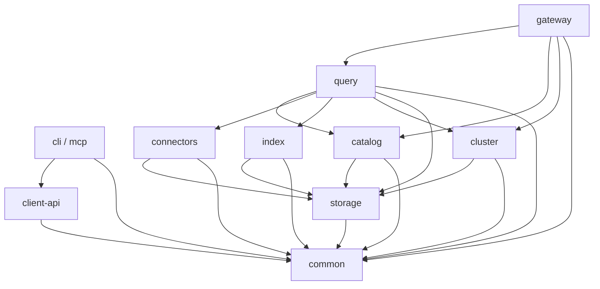

# 概要设计：模块边界与公共合同

**实施合同更新：** [模块交付合同](module-delivery-contracts.md)明确本轮具名 owner、资源/验收、Rust/Python 唯一权威与迁移出口；[策略 v2](../plans/2026-10-21-modular-delivery-v2.md)负责排程。本页继续保留目标 port/架构与长期不变量；执行安排冲突时采用 v2，不将未实现 port 当稳定 API。

日期：2026-10-20。状态：目标设计，公共类型、port、字段和状态名均是设计名，尚非已发布 API。本文细化[概要设计](outline-design.md)，决定见 [ADR 0018](../decisions/0018-outline-design-and-module-contracts.md)，执行见[并行计划](../plans/2026-10-20-parallel-delivery.md)。不修改当前机器依赖图，也不扩大[alpha 白名单](../user/features.md)。

## 1. 从场景和竞品确定边界

| 场景与设计问题 | 官方研究依据 | GuraDB 目标与取舍 | 必须证明的结果 |
| --- | --- | --- | --- |
| S1 接入、S4 刷新：写成功究竟代表什么 | [Qdrant 一致性](https://qdrant.tech/documentation/scaling/consistency-guarantees/)区分确认/顺序/读取，失败也可能已有部分应用；[Iceberg 可靠性](https://iceberg.apache.org/docs/latest/reliability/)说明原子元数据切换与乐观并发提交 | catalog 拥有操作意图/对账；connectors 拥有格式提交；源提交与视图发布各有权威和 fencing，不照搬副本参数作为事务合同 | 响应丢失先对账，重放不重复提交；失效 writer 和失效 publisher 分别被拒绝 |
| S2 同一证据检索、S3 复现：不同入口能否各自取 latest | [Vespa 架构](https://docs.vespa.ai/en/learn/overview.html)将请求处理、内容与配置职责分开；[2026-10-19 研究](../research/2026-10-19-database-products.md)记录各类一致性边界 | catalog 唯一绑定版本与授权，query 唯一拥有选择/检索语义；每个算子消费固定 QueryContext | SQL/HTTP/检索/训练选择返回相同 ID/version 与拒绝；不能重取 latest |
| S2 ANN、S4 索引维护：缺口是否会漏数据 | [LanceDB 重建指南](https://docs.lancedb.com/indexing/reindexing/)说明未索引数据扫描补偿、仅索引模式区别及维护空间成本 | index 只输出固定源的不可变产物和覆盖证明；query 决定补偿/等待/拒绝；catalog 决定可否发布 | 缺 shard、删除映射不符、旧 build 晚到均不得混入完整视图 |
| S3 大媒体训练、S5 多云：读取与保留由谁负责 | [LanceDB Blob 指南](https://docs.lancedb.com/tables/multimodal)、[版本指南](https://docs.lancedb.com/tables/versioning)体现按需读取与版本保留的联系 | storage 负责字节和缓存，connectors 负责格式/批次；catalog 拥有 pin 与回收资格，cloud backend 不拥有业务权限 | 不全量载入媒体；旧视图所需字节可取；缓存和云凭据不能绕过撤权 |

研究索引对应 [R01–R09](../research/2026-10-20-outline-design-evidence.md)：R01 为 Milvus 湖接入，R02 为 Lance，R03 为 Qdrant，R04 为 Vespa，R05 为 Weaviate，R06 为 ClickHouse，R07 为 PostgreSQL，R08 为云对象；Iceberg 是补充组件协议依据。前述 Qdrant、Iceberg、LanceDB 重建页于 2026-10-20 实时复查；其它竞品事实范围沿用所链研究，不是本项目实测。借鉴的是责任和失败合同；GuraDB 的对象湖、固定视图、训练 pin 与非 OLTP 目标由自身业务决定。

## 2. 当前落位与目标差距

| 当前代码事实（本轮只读审计） | 对应目标缺口 | 迁移约束 |
| --- | --- | --- |
| [Rust catalog](../../crates/guradb-catalog/src/lib.rs)由固定 manifest 生成 HashMap 与 hash 派生 view；[Python control](../../modules/catalog/control.py)使用 PG 目录 | 两条路径尚未由共同目录绑定 | 历史 manifest/ID 只登记映射，不自动重编号；保留显式 legacy 模式 |
| [Rust query](../../crates/guradb-query/src/lib.rs)读取各文件后构造 MemTable；[Python service](../../modules/query/service.py)另行服务固定视图 | 共同查询上下文、按需 provider 与检索算子尚待实现 | 先同视图/同语义再改读取布局，逐个算子差异验收 |
| [Jobs](../../modules/catalog/jobs.py)有持久 job/pin、128 条 job 上限及本进程 worker 恢复；[schema](../../modules/catalog/schema.sql)有 generation/epoch | 尚非通用租约作业、训练集管理或长期生命周期 | 不把扩大常量视为解决对账/保留/容量问题 |
| [Managed](../../modules/catalog/managed.py)明确依赖源 flock，与 PG 意图分开 | 仅本机提交权，不提供跨机 source fencing | 多机 writer 必须先通过真实源提交能力门槛 |
| [transport](../../modules/cluster/transport.py)是 loopback HTTP、3 worker、签名和分配预算 | 未验收远程 TLS、独立文件系统与长期任务调度 | 不以放开地址校验完成多机；先只读 POC |
| [common](../../modules/common/contracts.py)已有 Failure/Budget/ID 编码；[Rust protocol](../../crates/guradb-common/src/protocol.rs)有 ReadContext | 本文完整 QueryContext/ReadBatch/port 未实现 | common 保持值类型与抽象接口，不能下沉业务编排 |

## 3. 唯一归属与单向依赖

下列是 [architecture.toml](../../harness/architecture.toml) 允许边的分组表达，不是新的服务调用图；允许依赖不要求每条都实际使用。

| 模块 / 唯一所有权 | 输入 → 输出 | 明确不负责 | 目标运行角色 |
| --- | --- | --- | --- |
| common：ID、描述符、错误/预算/取消、port 及其版本语义 | 可验证值 → 不可变值/接口约束 | PG/S3 客户端、线程池、业务状态机、上层实现导入 | 库，不单独部署 |
| catalog：namespace/dataset/schema、权限、revision/read view、job、pin、发布/回收资格 | 身份、预期版本、操作意图/完成证明 → 绑定上下文、持久状态、发布决定 | 业务逐行数据、ANN算法、网络任务调度、外部表的原子事务实现 | catalog/job service；单机可与 gateway 合进程 |
| storage：对象寻址、完整性、范围读取、缓存、云对象适配及授权删除执行 | 固定 ObjectRef、读预算或回收许可 → 字节流/计量/删除回执 | 根据 LIST 判断事务提交、直接决定业务 GC、格式提交、租户授权规则 | query/background worker 内库；共享对象后端 |
| connectors：格式/源能力认证、schema映射、源快照枚举、原生提交与对账、训练格式编码 | 绑定源版本/受控写意图/选择结果 → ReadBatch、SourceCommitReceipt、训练产物描述符 | 最新视图选择、发布 read view、跨源事务、训练选择/排名语义 | query/background worker 的适配库 |
| index：BM25/ANN/有界邻接、物化布局与稳定 ID 映射 | 固定输入批次及构建配置/查询节点 → IndexArtifact 或候选/路径证据 | 独立接受业务写入、修改目录指针、决定主体权限、训练集保留 | query/background worker；可按资源池拆分 |
| cluster：任务分片/分配、传输、租约执行、取消/背压、资源池与计量归并 | 固定 TaskEnvelope/算子执行器 → 任务回执与资源用量 | 解释 SQL、改变过滤/排名、拥有 read view、源提交和发布授权 | coordinator 中调度库 + worker runtime |
| query：共同计划、关系/检索/图/训练选择、候选归并/回表语义 | QueryContext、类型化请求、port → 计划、ReadBatch、证据/选择定义 | 自建目录授权、在算子里重新绑定 latest、逐行远程 UDF | gateway/coordinator + query worker 的算子库 |
| gateway：HTTP/PG wire、认证入口、参数/会话、请求生命周期、受控媒体代理及公共错误映射 | 认证请求 → 规范请求/job/句柄/分页/固定对象版本的媒体字节 | 第二套 SQL/search/训练语义、将客户端 SQL 代理进元数据库、任意URL抓取 | gateway/coordinator |
| client-api、CLI、MCP：同一客户端语义 | 版本化远程合同 → 薄客户端任务/结果 | 直读内部 PG/产物、自算 split/RRF、导入 server 实现 | 用户端，服务外 |

**编排与依赖倒置：** query 的应用编排层调用 catalog 的状态/授权/发布接口，以及 common 中的 SourceCommitPort、ArtifactBuildPort、TaskDispatchPort；具体执行实现分别属于 connectors/index/cluster。query 的组合入口装配这些实现，gateway 只调用 query 暴露的组合入口及 catalog/cluster 已有允许依赖。catalog 仅拥有持久状态与发布决定，不 import index/cluster/connectors；后者也不 import catalog。完成回执由 query 编排者提交给 catalog；port 不允许调用者任意更新内部 PG 表。不能用动态 import、内部 HTTP 或共享文件绕开机器 DAG。

逻辑模块不等于微服务：首个单机预览保留合进程入口；目标四角色是 gateway/coordinator、catalog/job service、query worker、background worker。角色的 RPC 依赖必须同时满足身份、版本与执行合同，不为每个库建一个服务。PG 控制面与客户端 PG wire 是不同实例/端口和安全边界。

## 4. 冻结公共合同，而不是共享内部对象

所有合同包含 `contract_version` 和必要的能力声明。按[ADR0020](../decisions/0020-product-review-and-vertical-delivery.md)及实施计划分CF1-A共同读、B接入生命周期、C训练消费冻结；各生产切片所需的安全/副作用合同必须先完整冻结，后批不改变前批语义而不升级版本。以下列最低语义；字段编码、OpenAPI/schema、Rust/Python 映射在 P00 中评审冻结。本次没有新增可执行 API 或 schema。

| 合同 / 语义所有者 | 最低内容 | 生产者 → 消费者 / 禁止项 |
| --- | --- | --- |
| ResourceDescriptor / catalog | tenant、namespace/dataset 稳定 ID、显示名、schema ID/version、记录/资产/片段/特征/关系定义；坐标单位与模型空间 | catalog → 各模块；不可用表名/路径替代永久身份 |
| SourceVersion / connectors | source ID、格式/版本、精确 snapshot/metadata、schema field IDs、源能力和保留责任 | connectors → catalog；不可只有 `latest` 或可覆盖 URI |
| DataRevision / catalog | 不可变 revision ID、全部 SourceVersion/对象引用、schema、父关系、内容摘要和可读能力 | catalog → QueryContext/构建；多表版本集合不等于跨表事务时点 |
| ReadView / catalog | revision、必需索引及覆盖/删除语义、发布 generation/序、格式版本和描述符摘要 | catalog → 所有读路径；索引不得自行宣布 published |
| AuthContext / catalog | tenant/subject、授权操作/资源范围、policy epoch、有效期限与可验证委派引用 | gateway认证后由catalog解析 → 执行/句柄访问；不是可序列化长期 bearer token，不含云密钥 |
| QueryContext / catalog绑定、common表达 | request/query ID、dataset/schema、固定revision/view、源/索引引用、AuthContext、pin句柄、deadline、预算、trace、能力集 | catalog → query→各算子/cluster；不可省略检查后让worker自行补 latest |
| Job / catalog | operation ID/请求指纹、租户主体、kind、固定目标、generation、状态/attempt、进度、提交与索引就绪状态、错误/结果/保留引用 | gateway/编排者 → catalog持久化 → 调度；重试不得生成另一个逻辑操作 |
| SourceCommitIntent/Receipt / catalog意图、connectors格式事实 | op/fingerprint、表、expected parent、source epoch/能力、输入摘要、原生commit标识、确定/未知结果、已证实snapshot | query编排取得catalog意图→SourceCommitPort→回执登记catalog；不以网络成功/超时猜测是否提交 |
| SourceRetention/Maintenance Port/Receipt / connectors格式事实、catalog保留决定 | 源snapshot/对象引用集合摘要、保留期限/上游保护能力、维护操作/原生回执、证明有效范围/版本、未知/失败状态 | query编排调用connectors源格式维护/上游保护→回执登记catalog；catalog不能反向import连接器，缺有效证明禁止回收源可能引用的字节 |
| IndexArtifact / index | artifact/build ID、固定revision/schema、逻辑ID/version映射、模型/分析器/距离/参数、覆盖范围与删除水位、分片引用/校验、构建成本、reader能力 | index → catalog验证 → query读取；禁止私有 rowid 作为外部结果 ID |
| ReadBatch / common包络、connectors/query生成 | context摘要、schema/field IDs、batch序号/结束标志、Arrow schema与批次、逻辑ID/version、顺序/截断、计量与完整性 | provider/算子→下游；不随批次携带全量数据清单或完整凭据 |
| TaskEnvelope / cluster | task/attempt/op、owner/generation、固定context摘要、shard/算子版本、输入引用、剩余deadline/配额、取消域、trace | query/编排者 → worker；禁止进程本机绝对路径作为跨机数据身份 |
| TrainingSelection/Manifest/Pin / query选择、catalog保留 | 选择/处理计划摘要、sample及成员角色/版本、持久group/split映射、固定view、采样/尾批/并行拓扑、复现等级、输出格式、保留承诺/pin到期/释放状态 | query→connectors编码→catalog登记；pin不是访问授权、随机种子不能替代数据固定 |
| CloudAdapter / storage | 后端标识/endpoint、ObjectRef、范围/条件/版本/完整性模式与可信依据、块校验或缓存验证能力、短期凭据引用、加密引用、请求计量与错误分类 | storage port→AWS/兼容S3等实现；不返回云SDK对象给上层，不默认所有S3兼容 |

ReadBatch 在进程内传 Arrow 批次及受控所有权，跨进程使用经协商的 Arrow IPC 或等价有界编码；common 只声明版本化包络/抽象 port，不引入 query 的 DataFusion 计划或具体云 SDK。切换编码单独验证类型、NULL、完整 int8、字节长度、取消和背压；不能由格式可解析推断查询语义兼容。

### 4.1 同一上下文的绑定与撤权

1. gateway 认证并限流，catalog 在一致读取中检查资源/权限、解析指定或已发布视图并登记查询 pin，返回不可变 QueryContext。
2. query 一次规划；source/index provider、Graph 与训练选择只消费绑定版本。多 dataset 关联必须绑定完整版本集合和每个资源的授权；首片未覆盖的组合明确拒绝。
3. worker 校验上下文完整性、委派范围、能力和到期，使用版本化对象缓存键；缓存命中也执行权限/撤权检查。授权服务不可用时按合同失败关闭，不能继续用过期授权。
4. 分页、句柄访问、导出下载、训练每次批次读取与结果发布重新校验当前授权 epoch。撤权不通过改视图完成；不改变已固定数据版本，但终止后续受保护输出。已经交付给调用者的字节无法由数据库收回，需审计和数据使用治理。
5. 完成/取消释放查询 pin；训练/导出成功转为有期限持久消费 pin。源保留达不到承诺时拒绝复现等级；对象摘要不能恢复已被外部删除的字节。

媒体默认通过gateway受控代理按固定版本批量/Range访问，query回表绑定父资产/片段版本，storage核对对象版本/摘要；每次请求重查授权，限制scheme/host/bucket、逐跳重定向和出口地址。直接签名URL是单独显式合同，须披露有效期内撤销限制，不能用旧URL/旧句柄绕过撤权。S2验收必须实际取得图像/片段字节，返回URI不足以证明证据可访问。

### 4.2 按需执行与训练端口的补充

source/provider须准确标记谓词下推能力与剩余过滤，输出有界Arrow批次和I/O/内存计量；index候选携带稳定ID/version与定位，query批回表，不能把完整业务rows包装成描述符。ObjectRef校验模式区分固定版本/后端传输保护、已验证缓存和可信块摘要，不能用全对象摘要替代局部验证，细则见[运行设计](outline-runtime-and-operations.md)。

TrainingSelection的样本语义归query；connectors消费已冻结成员/组结果，不重新split。消费状态包含框架/采样器版本、epoch、并行拓扑、尾批、确认位置及支持的恢复级别，不能与普通query重试混同。集合完整性、采样次数/顺序和模型复现的责任按[训练合同](../product/training-contract.md)分层；大manifest放对象存储，catalog只存描述符与保留责任。

新鲜度与SourceRetentionReceipt包含来源/覆盖依据、期限、续期结果和失败状态；不能用最近轮询时间替代覆盖或把上游保留失败静默降为best-effort。这些字段随CF1-B冻结；I1只允许已保护固定输入的共同读范围。

## 5. 两种 fencing 与持久状态

### 5.1 源提交权

SourceCommitPort 必须声明 `single_authority_local` 或已认证的 `fenced_remote_commit` 能力。首个托管 writer 可继续限定单主机独占提交入口；不能由 PG lease、目录 CAS 或 Iceberg 的 expected-parent CAS 单独推导“过期 writer 绝不提交”。

允许多主机 writer 前，真实源端必须将提交权 epoch/持有者验证与格式提交原子点结合，或提供经故障验证的唯一提交权威，使旧持有者无法在交权后执行提交。仅先检查 PG generation 再请求外部 catalog 存在竞态；没有可验证能力就拒绝多机 writer/自动故障切换，不绕过成支持。

意图状态为 prepared → committing → committed；网络丢失进入 outcome_unknown/reconciling，只有证明原生提交不存在且不可再晚到才可 aborted。未知阶段阻塞同表后续提交，防止后续 append 携带未知 HEAD；确认后生成精确 revision。worker 只生成不可变输入文件，不能持有不受控源写权限。

### 5.2 目录发布权

ArtifactBuildPort 返回产物，catalog 验证目标 revision、job generation、索引集合/覆盖/删除/模型/权限规则，再用预期旧指针与发布序 CAS。新发布不能让旧 build 重新读取新指针后回退；显式数据恢复是单独审计操作，不是旧作业自然完成。源已提交而索引失败时报告 `data_committed=true, search_ready=false`，旧合法视图仍可读。取消索引不撤销已确认源提交。

Job 设计状态为 queued → running → succeeded/failed/cancelled；提交副作用未知使用 `reconciling` 子状态并公开“取消请求已接收，结果待对账”，不得提前返回“已无副作用”。数据提交、建索引、发布进度分别持久化；attempt 可重复，终态和逻辑发布不能重复。恢复按 op/源回执/产物/指针核对，不能仅将所有旧进程 job 重新排队。

### 5.3 Pin 与 GC

catalog 是引用图和删除资格唯一所有者：当前/历史视图、源表、查询、训练、导出及在途提交均参与检查。query 编排调用 connectors 的 SourceRetention/Maintenance Port，完成源格式保留保护/维护并取得原生引用证明回执，登记catalog引用与资格；维护结果未知则先对账，不能将“目录没有引用”推为“源表没有引用”。外部源无法提供保护/证明时披露保留等级，并禁止删除其拥有或仍可能引用的文件。

GC 先标记 retiring，catalog核对有效源维护回执、内部引用和grace，再冻结删除许可，由storage仅对GuraDB拥有且证明无源引用的对象执行删除并回执。许可必须有对象版本/摘要和generation，不能根据前缀扫描直接删。新pin与retiring竞争在目录中串行化；源格式自己的snapshot expiration仍需对应原生维护合同，GuraDB pin不自动约束外部管理员。catalog不调用connectors，storage不自行执行Iceberg快照过期。

## 6. 错误、重试、预算与可观测性合同

| 类型 | 统一处理 | 可重试性与断言 |
| --- | --- | --- |
| invalid/unsupported/schema/model | 网关和语义层返回稳定错误类；PG SQLSTATE/HTTP code只是映射 | 同请求不重试；不得解析后忽略未支持字段/删除语义 |
| unauthorized/revoked/expired-context | 各访问边界失败关闭；对外避免泄露资源存在性 | 只能重新认证/绑定，旧context不能扩大权限 |
| conflict/stale-generation | catalog/源端返回预期与实际的安全诊断引用 | 原操作先对账；重新规划是新决策，不自动覆盖 |
| outcome-unknown | 保留 operation、输入/源证据，返回可查询状态 | 不盲重试写；连接失败不等于未提交 |
| transient/backend-unavailable | storage/cluster分类，有限退避并计入同一deadline/请求额度 | 只对幂等读取/任务attempt重试；每次请求计费，不重置预算 |
| cancelled/deadline/resource-limit | 贯穿算子、远程任务、对象请求、队列与spill | 禁止后台继续无限工作；已发生副作用按作业状态对账 |
| missing/corrupt/version-incompatible | 绑定版本失败或校验失败，保留诊断 | 不切latest、不跳坏shard、不把残缺结果标完整 |

预算包含总deadline、内存、对象请求/字节、候选/Top-K、图扇出/边、输出/训练字节、并发和临时磁盘。父请求划分子额度，worker回执归并；队列等待、重试、校验、预取和取消清理都计时/计量。时钟之间传剩余TTL并校验最大允许值，不能延长原始截止时间。物理资源须由执行器真实限制，字段存在不是执行证据。

每模块以 request/query/op/job/task/view/revision/artifact/pin ID 串 trace；指标区分排队/执行/对象I/O/补偿/回表/取消，对齐[运行与运维设计](outline-runtime-and-operations.md)。跨租户标签/SQL/媒体URI/凭据不得直接进入低权限日志；结构化错误有安全诊断ID和独立运维权限。

## 7. 版本、测试替身与真实集成门槛

| 边界 | 模块并行时的替身/合同测试 | 宣称联通前的真实集成与负例 |
| --- | --- | --- |
| common↔所有模块 | golden 编码、未知required能力、Rust/Python round-trip、兼容旧fixture | 真实跨语言/协议传递，拒绝不兼容reader与语义降级 |
| query编排↔catalog状态+源/构建/调度port | 可注入丢响应、旧generation、重复attempt的确定性fake | 真实PG+格式catalog+对象后端，提交与发布分别崩溃/晚到；mock不能证明事务 |
| storage↔connectors/index | 固定ObjectRef的内存/本地后端、范围/错误fixture | 真实认证后端、version/range/checksum/限流/对象丢失/取消；各云认证单列 |
| query↔providers | 小型Arrow批次、精确L2/BM25/关系真值、固定图 | 同dataset SQL/HTTP及训练选择、真实索引/媒体回表；NULL/权限/模型/缺shard不被补默认 |
| cluster↔worker | 可控重复/迟到/取消的transport fake | 至少3台独立主机/文件系统及真实对象I/O；资源总计、网络隔离、worker死亡、凭据轮换 |
| 训练↔生命周期 | mock clock/引用图、SourceRetentionReceipt与逐值小样本 | 独立reader、发布/撤权/pin/GC竞争、源维护/重启/保留到期；源仍引用或回执未知时不删除，导出sample集合完整唯一、成员版本对齐；消费按采样策略核对 |

contract freeze 包含schema、语义向量、错误/预算、能力协商、兼容矩阵与所有者签字；未freeze前只做原型。兼容分线：公共请求版本、持久描述符版本、算子/worker协议版本、外部格式版本；未知必需能力拒绝，未知可选字段仅在规定可忽略时接受，不能泛用“忽略未知字段”。支持窗口由实测矩阵声明，不预承诺任意新旧版本混跑。

持久迁移采用新描述符并存/显式映射 → 双reader差异验证 → canary绑定 → 切换新写 → 等旧job/pin窗口 → 退役旧reader；双reader用于验证，不让两套目录同时拥有发布权。回退二进制前检查新产物与schema是否可读；不能读取时停止新写/保留证据并向前修复或恢复联合备份。旧M0 manifest与旧索引reader只在替代范围、保留与真实恢复门槛满足后移除。
