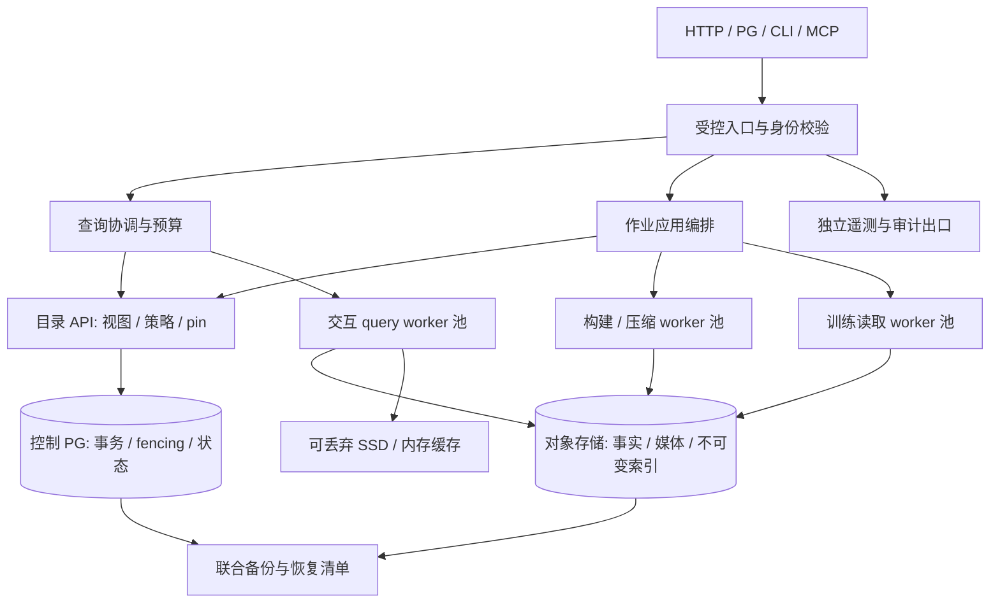

# 概要设计专题：运行、性能、云适配与安全

日期：2026-10-20。本文属于[概要设计](outline-design.md)，研究入口见[证据索引](../research/2026-10-20-outline-design-evidence.md)。
本文细化推荐方案及验证义务，没有新增运行时功能、生产能力或云认证；实际白名单仍见[用户能力](../user/features.md)。
场景编号沿用总纲：S1 接入与数据准备，S2 混合检索，S3 可复现训练，S4 生命周期，S5 治理与部署。
竞品编号沿用研究索引：R01 Milvus、R02 LanceDB、R03 Qdrant、R04 Vespa、R05 Weaviate、R06 ClickHouse、R07 PostgreSQL、R08 云对象存储。
“目标”是业务需求推导的提案；“已实现”只能由当前代码和匹配 commit 的报告确认；竞品文档不构成本项目测试证据。

## 1. 部署架构与故障域

### 1.1 场景和竞品依据

S1 的刷新/构建、S2 的交互请求、S3 的长扫描具有不同资源形态；S4 要求独立恢复，S5 要求权限与租户边界。
[Milvus 当前架构 R01](https://milvus.io/docs/architecture_overview.md)将入口、协调、worker 与共享存储分层，并允许计算独立扩展；这里仅借鉴职责分离，具体版本能力以研究索引的 3.0.x 证据为准。
本项目据此采用逻辑角色和资源池分离，但沿用已有 PostgreSQL 小型控制面及固定 read view，不引入 Milvus 的写入链路作为前置依赖。
[Weaviate 租户模型 R05](https://docs.weaviate.io/weaviate/concepts/data)把租户数据划入独立 shard，并为非活跃状态明确拒绝访问；启发本项目把隔离与可用状态作为合同。
设计目标是同一对象/查询/权限语义可从本地预览扩展到多机，训练和构建不能无限挤占在线查询，也不能把单机共享目录视为跨机存储协议。

### 1.2 目标拓扑

图中是逻辑关系，不新增模块依赖；应用编排归 query，状态和事务归 catalog，执行资源归 cluster，云对象 I/O 归 storage。
API 语义由 gateway/query/catalog 的既有归属承接；遥测 SDK 不成为业务模块反向依赖，机器 DAG 仍以 [architecture.toml](../../harness/architecture.toml) 为准。
入口可以负载均衡；协调进程重启后必须从目录恢复或明确结束作业，不能仅靠另一个进程接流量宣称透明恢复。
worker 不持有最终发布权；生成不可变产物和校验摘要后，由受控发布入口校验 operation、目标 revision、租约及 generation 再 CAS。
本地 SSD 只存可重建缓存/临时输出；worker 丢失不能丢失已经确认的事实数据。GPU/OCR/ASR/embedding 作为独立后台执行资源，不承担模型 serving。

| 部署档位 | 场景与边界 | 必要资源与隔离 | 晋升验收 / 状态 |
| --- | --- | --- | --- |
| E0 本地评估 | S1–S3 合成数据、受控 loopback | 当前两个服务路径、本机 PG/对象服务/worker | 已有有界操作；不声明生产安全或 HA |
| E1 单机产品预览 | 一个入口完成接入、检索、训练、生命周期 | 可合并角色进程，但身份/资源/目录合同一致 | 待实现；安装产物、完整旅程、升级和备份必须另验 |
| E2 多机 | S2/S3 并发与独立扩容 | 至少 3 台独立主机/磁盘，私网对象存储，角色队列/配额 | 待实测；跨机取消、重试、分片迁移、超缓存工作集 |
| E3 生产 HA | S4/S5 故障域和持续运维 | 控制 PG HA、入口冗余、worker 分散、受控网络、独立备份 | 待 release 验收；Kubernetes/托管 PG 本身不证明 GuraDB HA |

### 1.3 故障、维护和恢复目标

入口无权确认的授权必须 fail closed；控制 PG 不可用时停止新发布/写入及无法重新授权的访问。
远端 task 使用显式 deadline/cancel、operation 和 generation；重试只重算可重入阶段，未知源提交先对账再继续。
扩缩容先生成新 shard manifest、核对覆盖与稳定 ID、完成校验，再以新发布 epoch 切换；旧任务不能覆盖新路由。
发布失败保留旧合法视图；单路 ANN/全文/Graph 构建失败不能触发组合视图的部分发布。
升级采用 reader/writer/产物版本矩阵、排空或可恢复作业、先备份后迁移；回退二进制不等于回退持久格式。
恢复清单须包含 PG 恢复点、源 catalog 版本、事实/媒体闭包、必要特征、索引或重建方案、视图、pin、策略 epoch、密钥引用和校验摘要。
当前离线联合恢复是已有有界切片；在线一致备份、PITR、跨主机/跨地域恢复仍待验证，见[生产缺口](production-acceptance-gaps.md)。

| 待预注册恢复档位 | 提案目标 | 必须量测的终点和失败条件 |
| --- | --- | --- |
| 本地预览恢复 | 初始候选 RPO ≤ 24 h、RTO ≤ 4 h | 从发现故障计时，至数据/权限/训练引用及后续提交验证完成；缺失媒体即失败 |
| 目标生产部署 | 由业务确定允许数据损失与停机窗口，不能沿用预览数字 | 覆盖目录/对象恢复点偏差、源未知提交、密钥、索引重建/预热与备份后撤权补偿 |
| 异地灾备 | 先验证地域许可与复制成本，再提出 RPO/RTO | 在独立环境恢复，不以对象副本存在或 PG 能启动作为完成 |

这些数字仅用于制定演练方案，不是已测能力、SLA 或默认配置；恢复约束不降低“已确认提交不可静默丢失”的正确性义务。
备份后新增提交若不在恢复点内，必须按 operation 对账并披露损失范围，不能伪装成已被恢复。

## 2. 性能实现与资源预算

### 2.1 场景和竞品依据

S2 要在正确授权/固定版本下交互返回，S3 要持续喂给训练消费者，S1 构建与 S4 保留不能拖垮两者。
R01 的计算/存储分离说明不同节点可独立扩展；[Milvus 当前存储说明](https://milvus.io/docs/architecture_overview.md)也明确对象访问延迟与请求费用的问题。
因此设计重点是批量 I/O、裁剪、缓存与资源隔离；不由“对象存储便宜”推导冷随机读取同样便宜，不引用竞品 QPS 作为本项目承诺。
目标是保持同一结果/recall/过滤完整性，降低每个有效结果和每个训练样本的请求、字节、CPU、内存与等待。

### 2.2 关键实现机制

| 路径 | 推荐实现 | 必须保留的不变量 / 失败策略 |
| --- | --- | --- |
| S1 接入 | 固定源版本、批量文件发现、并发有界下载、按摘要复用可信旧副本；小文件合并另生成 revision | LIST 不是快照；未知提交不盲重放，外部旁路 writer 不默认安全 |
| S2 关系扫描 | DataFusion/Arrow 批次、列投影、分区/文件/行组裁剪，剩余谓词在执行层完成 | 不能因下推不支持而忽略过滤；超内存拒绝或经认证 spill |
| S2 向量 | 精确检索作真值；Lance 物化固定 revision，验证 IVF/PQ/精确重排及过滤候选扩张 | 同一逻辑 ID/版本；recall 和删除可见性同时验，预算不足不假装完整 |
| S2 全文/融合 | 全局 BM25 统计或显式近似标记、稳定 tie-break、RRF、稳定 ID 去重 | 不直接相加异量纲分数；不能只优化某 shard 而漏全局 Top-K |
| S2 Graph | 固定视图邻接访问、方向/属性裁剪、逐跳去重、有界扩展并保留路径证据 | 不越权泄露路径；达到扇出/边数上限需明确截断合同或失败 |
| S2 回表/媒体 | 批量聚合物理位置、按相邻范围合并请求、版本/摘要校验、受控代理 | 不以旧候选回最新事实；媒体权限与结构化结果分别复查 |
| S3 训练 | 固定样本 manifest、列裁剪、范围预取、批次/分片读取、局部性友好混洗 | 导出集合完整唯一；消费按采样策略核对，group/split、处理版本及声明的恢复级别可追溯 |
| S4 维护 | 构建/compaction 独立队列、限额临时空间；新产物验证后再发布 | 源引用、保留与 query/train/build pin 都结束后才清理 |

缓存键至少包含租户、dataset、对象固定版本/摘要、范围和解码版本；权限策略单独校验，命中数据缓存不能授权。
小范围请求采用单范围为核心原语，合并阈值由 GET 费用、额外读取字节与延迟共同决定；不跨版本拼接响应。
缓存亲和调度只影响性能，不改变 task 身份；worker 迁移、冷启动和缓存淘汰须保持同一查询语义。
内存核算覆盖 Arrow、native ANN、Python/Rust 进程、回表缓冲和子进程；进程 RSS 与分配器统计同时观察。
首个多 worker 切片只做扫描/检索归并与训练读取；复杂 distributed JOIN、shuffle/spill 必须有独立设计和验收，不视为 DataFusion 自带能力。

### 2.2.1 按需读取与完整性

规模晋级必须替换当前全量MemTable、协调器全量rows和每请求校验所有产物路径。固定快照provider负责列/文件/行组裁剪，准确声明Exact/Inexact/Unsupported谓词下推；Inexact保留剩余过滤。候选返回稳定ID/version和必要定位信息，回表按对象/相邻范围批量合并；coordinator仅持必要描述符、有界候选和批次缓冲。对全局排序/关联等算子另测内存/spill或明确拒绝，不能泛称所有SQL内存与数据量无关。

完整性模式在CF1-A的ObjectRef与P03详细设计中冻结，P04/P10共同验收：

| 校验方式 | 可以证明什么 | 必需约束/负例 |
| --- | --- | --- |
| 固定对象版本+可信清单+后端传输校验 | 读取选定对象版本，并提供已认证后端的传输保护 | 声明信任边界；不能等同独立验证任意Range内容SHA-256；覆盖/版本失配/后端无版本能力拒绝 |
| 首次全对象校验后受控缓存读取 | 已验证缓存对象的内容身份 | 缓存绑定版本/摘要，读时保护文件不被替换；验证I/O/CPU计入首次和冷读成本，缓存失效重新验证 |
| 认证的块摘要/证明 | 返回范围所在块与可信摘要绑定 | 固定分块边界/算法/清单来源，读取完整校验块再裁切；跨块/短读/乱序/篡改/旧缓存负例 |

单独的整对象SHA-256不能验证局部Range。要求强局部完整性但后端/清单不具备能力时，预算内全对象校验或明确失败；不能为了Range提速省略已承诺校验，也不强制所有后端首片实现块证明。清单在可信登记/发布链验证，缓存命中继续校验授权；“可信”须在后端认证中有可验证依据。

上述provider方向参考2026-10-20核对的[DataFusion官方扩展指南](https://datafusion.apache.org/library-user-guide/custom-table-providers.html)，实施须按本仓库锁定版本确认API，不由最新版文档推导当前代码已具备能力。

### 2.2.2 三层质量与维护成本

P01/P14分别保存算法真值（同过滤/同view的精确ANN/全局排序）、业务真值（独立相关性标注、nDCG/MRR、证据版本/坐标与无答案集）和系统指标（冷热延迟、请求/字节、RSS、构建/保留成本、混合负载）。RRF分数不是概率；若提供无答案阈值，须在独立验证集校准并在固定测试集验收。Graph首先验证一跳证据的业务增益，不用更多跳数代替质量。

每份全局/分片ANN、全文布局、serving列副本和训练导出登记用途、owner、构建/读取/历史保留/恢复成本。append全量重建仍是当前实现；后续分段增量、同版完整补扫与重建作同质量/同新鲜度对照，缺覆盖不得作为完整成功。当前多份产物不能未经兼容/性能证据直接删除；layout选型以独立ADR收敛。

### 2.3 参考测量档位和候选预算

下列为可复现测量建议，未运行，不是容量结论；固定发行镜像、CPU/NUMA、磁盘、带宽、对象 endpoint、依赖锁、压缩和 seed 后才能使用。
R1/R2 是本文的测量档位标识，与研究编号 R01–R08 无关；真实业务数据可另建档位，不能替换前后比较的输入。

| 测量档位 | 固定输入建议 | 资源建议与用途 |
| --- | --- | --- |
| F0 当前 fixture | 现有验收 driver 的原始数据/参数 | 验证已有有界行为；不得外推产品规模 |
| R1 模块规模 | 100 万记录、768 维 float32、文本/属性、100 GiB 媒体/事实闭包 | 单 worker 8 vCPU/32 GiB RAM，SSD 缓存 16 GiB；测裁剪/ANN/回表与限额 |
| R2 多机与混合 | 1,000 万记录、候选768维、1 TiB闭包；热点/长尾、过滤选择性0.1%/1%/10%/100% | 3台worker各8 vCPU/32 GiB、SSD各64 GiB；仅为候选规模，须另证被测工作集超过相关缓存 |

原始向量大小按 `record_count × dimension × 4` 计算；实际必须另计媒体、文本、图、索引、历史版本、临时构建和备份放大。
同一档位分别运行真冷、暖、部分命中；超缓存按事实列、原始向量、ANN/全文索引、媒体与元数据分别证明实际访问字节及可用内存/SSD缓存。1 TiB媒体闭包不证明ANN工作集超缓存；R1/R2规模不足时按预注册方式扩大相应工作集或约束缓存，不能事后换负载。768维是候选值，首批按真实模型冻结，当前256维上限不变。清理应用/OS缓存的方法和无法控制的云端缓存都必须披露。
固定查询集含高/低选择性过滤、重复逻辑 ID、删除、缺索引、偏斜 shard、多语言全文、Graph 扇出和无结果。

| 候选目标（提案，待预注册） | 适用前提 | 验证与取舍 |
| --- | --- | --- |
| S2 暖 p95 ≤ 1 s，冷 p95 ≤ 5 s | R1、并发 10、Top-10、固定查询集；Graph 复杂请求独立统计 | 只是首轮交互体验假设；同时记录 p99、排队、recall、GET/字节/成本 |
| ANN recall@10 ≥ 0.95 | 同一过滤、视图、精确真值和去重规则 | 不能为延迟目标降低召回；业务相关性/NDCG 单独评价 |
| S3 吞吐 ≥ 直接投影扫描对照的 70% | 同机同输入、同样本选择/投影/解码；对照无需额外治理时披露差异 | 同时记录样本覆盖、CPU/GET/字节和 pin 成本；不以减样本提速 |
| S1 发布新鲜度候选 ≤ 15 min | 预注册单批规模、更新频率、索引集合和硬件 | 区分 source-observed→committed、committed→indexed、indexed→published |
| S2+S3+构建隔离 | R2 同时运行固定在线/训练/构建负载 | 先报告相对退化并按业务选预算；不预先承诺混合负载 SLO |

准入硬限额与服务体验目标分开：每租户设置并发/排队/内存/SSD/对象请求/扫描字节/结果行数/执行时间/Graph 扇出预算。
建议首个新 driver 探索每 task 512 MiB 内存、64 个在途对象请求和明确 deadline，但必须按 native 内存与目标环境验证后才能成为配置。
限制贯穿 coordinator 和远端 worker；累计预算由父任务授予子任务，重试不凭空获得新额度。超限失败须标明已消耗值与限制项。
在线、训练、构建使用独立队列及保底/上限；大租户可独立池，小租户共享池需要验证 noisy-neighbor；不承诺 CPU 配额即覆盖网络/SSD 隔离。

### 2.4 SLO 预注册和现有门禁

1. 由场景 owner 冻结业务完成条件、质量真值、输入 manifest、查询分布、缓存模式、并发、背景负载和环境摘要。
2. 在首次运行前记录绝对目标、成本/内存上限、计时边界、超时和失败样本处理；把上述候选目标接受/修改的原因写入测量方案。
3. 先完成正确性与负例，再做至少 5 次独立测量，保留原始分位数、seed、trace、请求/字节、峰值 RSS、构建时间和存储放大。
4. 首次结果是候选基线；报告噪声、置信范围和失败，不能将筛选出的最好一次设成产品基线。
5. 独立复核后按工作负载/云/部署档位接受目标，作为后续同环境比较依据；新增数据集需重新预注册。

现有 [workloads.toml](../../harness/workloads.toml) 的至少 5 次、最大离散 30%、p95/p99/GET/字节/RSS 相对回归 10%、吞吐 5%、recall 不回退继续有效。
这些相对阈值不是产品 SLO；本文不改变任何门禁、超时或 ready/planned 状态，达到体验假设也不能跳过正确性/稳定性。
状态：已有组件 performance-smoke；完整性能、多机、隔离、长期趋势和产品 SLO 仍待测。

### 2.5 新鲜度与长期维护验收

源覆盖水位、observed/committed/indexed/published分别记录；源被轮询的时刻不能充当数据覆盖时刻。CF1-B冻结允许滞后、等待/失败和固定历史回放的互斥规则；源无法提供可信水位时返回不可证明满足，不制造新鲜度成功。更新频率/大小固定后测发布滞后分布和构建放大。

I2真实试用前验收通过受支持完整snapshot重建完成替换/下架/标签修订，旧view保留、撤权和强制擦除分开。G2需跨越128个run/job验证归档/配额、幂等对账记录保留、pin续期/过期、GC安全与长期资源趋势，不能只增大常量。上游保留失败阻止新承诺并对既有受影响承诺告警/对账；删除动作仍需源维护回执，未知结果不得当垃圾。

## 3. 可观测性与操作闭环

### 3.1 场景和竞品依据

S1 需要知道停在发现/提交/索引还是发布，S2 需要解释慢/漏/旧，S3 需要追溯训练集，S4/S5 需要恢复和权限证据。
[Databricks 系统表](https://docs.databricks.com/gcp/en/admin/system-tables)统一观测成本、作业和访问活动；它的地域/保留边界表明遥测也需要数据政策。
[OpenTelemetry signals](https://opentelemetry.io/docs/concepts/signals/)提供 traces、metrics、logs 等信号模型；本项目推荐兼容 OTel 出口，避免把某云监控 SDK 写进业务协议。
目标是每个用户可见失败都有稳定错误、trace 和恢复入口，每次性能/故障结论可绑定代码、数据、配置和实际运行证据。

### 3.2 信号与关联键

| 观察面 | 必备信号 | 用户问题 / 验收 |
| --- | --- | --- |
| 请求 | query/job/trace ID、版本集合、策略 epoch、排队/执行/回表时间、结果/错误/取消原因 | 解释“为什么慢/旧/失败”；HTTP/PG/CLI/MCP 使用同一关联语义 |
| 检索 | shard 覆盖、候选/过滤/重排/去重数量、ANN 参数、缺索引补偿、图扩展量 | 对照真值发现漏读；recall 是离线带真值指标，不能伪造在线实时 recall |
| 源与发布 | observed/committed/indexed/published 水位、revision/epoch、CAS 冲突、孤立产物 | 定位新鲜度和旧构建拒绝；不能用一个时间戳代替覆盖证明 |
| 资源 | 每池队列/并发、RSS/native 内存、SSD、对象 GET/HEAD/LIST/PUT/重试/字节、网络/shuffle | 发现超限与 noisy-neighbor；重试和失败 I/O 也计成本 |
| 生命周期 | pin 数量/年龄/owner、retiring 阶段、GC 候选/阻塞原因、备份年龄/恢复校验 | 解释不能删除/回收；pin 泄漏和外部过期必须告警 |
| 权限与安全 | 授权结果/策略变更、撤权传播、下载/导出、特权操作、审计投递失败 | 证明缓存/旧视图/恢复不会绕过撤权 |

指标维度使用受控枚举/池/错误码；dataset、query、对象 URL 等高基数字段放受保护 trace/log，不直接作为无界 metric label。
默认不记录 SQL 字面量、文本/向量/媒体内容、token、DSN、签名 URL、密钥或个人信息；诊断开关有权限、期限、脱敏和关闭证据。
链路上 baggage 只携带白名单标识，不能承载凭据；worker 跨进程保持 trace 与父 task 关系。
审计是独立信号，不能用采样性能 trace 代替；指标/trace exporter 故障要背压有界，不能使查询无限占内存。

### 3.3 告警与故障验收

每条告警要定义窗口、用户影响、关联信号、runbook 和恢复判据；阈值由预注册负载确定，不把“CPU 高”直接等同业务失败。
优先覆盖授权不可用/撤权失败、发布/源对账卡住、视图新鲜度超限、队列/预算耗尽、磁盘水位、pin 超期、备份失败和审计投递失败。
告警必须测试触发、去重、恢复与信息脱敏；日志中只有异常字符串而没有告警路径不算完成。
与 [faults.toml](../../harness/faults.toml) 对齐，至少实际注入上传后崩溃、响应丢失、发布前崩溃、索引部分失败、旧 builder/writer、worker 丢失/重复、对象限流、GC/pin 竞争、外部过期、撤权和高扇出取消。
每个场景保留 seed、注入时点、版本/epoch、trace、资源峰值及独立真值；没有实际注入的项目保持 planned。
状态：已有状态快照/日志和组件故障切片；统一遥测、生产指标/告警、不可篡改审计和全故障矩阵待实现/验证。

## 4. 云厂商适配与认证矩阵

### 4.1 场景、证据与设计目标

S1 要接企业已有湖，S2 要低成本 Range，S3 要同区域训练，S4 要保护历史字节，S5 要复用云身份/密钥与地域治理。
R01 支持共享对象存储的思路不证明任意 S3 endpoint 语义相同；R08 官方 API 已显示条件写、版本、Range 和保留具有实质差异。
目标是 `storage` 对象接口隔离厂商，`connectors` 负责格式/catalog 语义；身份提供者与配置不进入稳定记录身份，不为每云建立一套查询含义。
适配认证对象是“厂商 + 区域 + API/SDK 版本 + bucket 类型/版本/加密/保留配置”，不是仅认证品牌。

### 4.2 数据与并发语义矩阵

下表为 2026-10-20 核对的官方文档能力及 GuraDB 认证要求；全部公有云组合仍为待认证，本地 S3 兼容测试不自动晋升。

| 云 | API / 固定版本 / Range | 条件操作差异与认证重点 | 保留差异与状态 |
| --- | --- | --- | --- |
| AWS S3 | SigV4 REST；versionId；核心单 Range GET | [If-None-Match/If-Match 条件写](https://docs.aws.amazon.com/AmazonS3/latest/userguide/conditional-writes.html)；并发删除可能 409/404，multipart 完成需专测 | [Object Lock](https://docs.aws.amazon.com/AmazonS3/latest/userguide/object-lock.html)与版本/模式关联；验证 hold/到期/恢复；待认证 |
| Azure Blob | Blob REST，显式 x-ms-version、versionId/snapshot；[Range/x-ms-range](https://learn.microsoft.com/en-us/rest/api/storageservices/get-blob) | [ETag If-Match](https://learn.microsoft.com/en-us/azure/storage/blobs/concurrency-manage)冲突 412；lease 与 block commit 不等价本项目 fencing | [不可变存储](https://learn.microsoft.com/en-us/azure/storage/blobs/immutable-storage-overview)的容器/版本策略与 hold 分别认证；待认证 |
| GCP GCS | JSON/XML API；generation；按固定 generation 读取范围 | [generation/metageneration precondition](https://docs.cloud.google.com/storage/docs/request-preconditions)，0 表示无 live object；XML multipart 不支持该前提，不能照搬 S3 | [Bucket Lock](https://docs.cloud.google.com/storage/docs/bucket-lock)锁后不能缩短/移除；对象级策略单独测；待认证 |
| 阿里 OSS | 原生 OSS API/签名，versionId；[GetObject Range](https://www.alibabacloud.com/help/en/oss/developer-reference/getobject) | [防覆盖头](https://www.alibabacloud.com/help/en/oss/developer-reference/copyobject)在启用/暂停版本时无效，不能当通用 ETag CAS；源读条件与目标写条件分测 | [BucketWorm](https://www.alibabacloud.com/help/en/oss/user-guide/oss-retention-policies)与 ObjectWorm 互斥；保留/版本组合锁配置测试；待认证 |
| 腾讯 COS | COS REST/原生签名；versionId；[单 Range/If-Match GET](https://cloud.tencent.com/document/product/436/7753) | [x-cos-forbid-overwrite](https://cloud.tencent.com/document/product/436/7749)启用版本时无效；不得从 GET 条件推导覆盖写 CAS | [对象锁定](https://cloud.tencent.com/document/product/436/55293)有白名单/多 AZ 限制，锁定不能关闭；先确认账户和桶可用；待认证 |

OSS 官方 GetObject 页在本次查询时描述显式 header 启用多 Range、最多 50 区间且按区间计费；旧 Range 专题仍有“单范围”文字。
核心接口因此只依赖单 Range；多 Range 是厂商扩展，必须锁 API/SDK/地域和返回类型实测，不能据旧调研推定当前支持，也不能直接对全云开启。
所有适配检查实际 Content-Range、响应长度、版本和摘要；忽略 Range 返回全量时不能计为优化成功；gzip/transcoding 与字节偏移一致性单测。
对象条件写只能保护该对象操作，不替代目录 CAS、源 catalog fencing 或跨源事务；不具备所需语义时拒绝托管 writer 或使用经认证的受控提交协议。

### 4.3 身份、密钥、网络和成本矩阵

| 云 | 推荐身份 / 密钥边界 | 网络、外网和认证重点 |
| --- | --- | --- |
| AWS | [IAM role 临时凭据 / SSE-KMS](https://docs.aws.amazon.com/AmazonS3/latest/userguide/security-best-practices.html)，对象权限和 KMS 权限分别授予 | [S3 计费](https://aws.amazon.com/s3/pricing/)按区域/请求/存储级别/取回/传输核算；私网 endpoint 及跨 AZ/区域费用单列 |
| Azure | [Entra ID + managed identity](https://learn.microsoft.com/en-us/azure/storage/blobs/authorize-access-azure-active-directory)；[Key Vault CMK](https://learn.microsoft.com/en-us/azure/storage/common/customer-managed-keys-configure-new-account) | [Blob 计费](https://azure.microsoft.com/en-us/pricing/details/storage/blobs/)区分读写、取回、复制/传输；验证私网 DNS、SAS/身份轮换与 national cloud endpoint |
| GCP | workload 身份联邦/service account 凭据适配待认证；[Cloud KMS CMEK](https://docs.cloud.google.com/storage/docs/encryption/customer-managed-keys) | [GCS 计费](https://cloud.google.com/storage/pricing)按 location/目的地分流量；同地与 multi-region 不可简单等同；KMS 不隐藏对象名/多数元数据 |
| 阿里 | [RAM 最小权限](https://www.alibabacloud.com/help/en/oss/user-guide/ram-policy/)和 STS 适配；[SSE-KMS 读取权限](https://www.alibabacloud.com/help/en/oss/developer-reference/perform-range-download)单独验证 | [OSS 计费](https://www.alibabacloud.com/help/en/oss/billing-overview)包含请求/公网出流量；同地域内网 endpoint、取回和跨区域副本分别核算 |
| 腾讯 | CAM 角色/STS 临时凭据；[SSE-KMS](https://cloud.tencent.com/document/product/436/63744)验证 HTTPS、密钥访问与轮换 | [COS 流量](https://cloud.tencent.com/document/product/436/53863)区分内网/公网/CDN/跨域复制/加速；同地域内网规则实测，不能只看域名后缀 |

成本模型为：计算 + 控制 PG + 缓存盘 + 各类持久字节月 + 请求 + 取回 + KMS + 网络传输 + 日志/审计 + 备份/复制。
按 1,000 次有效检索、100 万有效训练样本、每批接入和每次恢复分别出成本；金额在区域/币种/日期/合同固定后计算，不在本文硬编码价格。
测试必须含 token 过期/轮换、KMS 拒绝/禁用、TLS/私网 DNS 错误、403/404/412/429/5xx、Range 异常、版本过期、multipart 响应丢失和保留阻止删除。
认证产物包含配置指纹、官方依据日期、正负例 trace、结果/字节/请求对账；只通过 GET 不能标注支持安全写入、保留或生产恢复。
状态：多云适配是目标；当前仅已有有界本地 S3 路径，具体范围见[兼容矩阵](../compatibility/lake-formats.md)和实际报告。

## 5. 安全、隐私与合规设计

### 5.1 场景和竞品依据

S1 的源凭据、S2 的候选/分数/路径/媒体、S3 的训练导出、S4 的历史/备份、S5 的管理入口都是数据出口。
[Databricks Unity Catalog](https://docs.databricks.com/gcp/en/data-governance/unity-catalog)把资产、权限、血缘和审计纳入共同治理面；R05 租户隔离补充了物理布局隔离的参照。
本项目目标是同一 principal/tenant/dataset/policy epoch 贯通所有入口与 worker，先交付数据集级最小权限，再逐项认证行列/标签策略。
不能把两个现有 token 配置当统一身份，也不把单路认证正例当全系统隔离证明；当前缺口见[安全手册](../user/security.md)。

### 5.2 权限、撤权与媒体

| 边界 | 推荐合同与方案 | 必须验证的负例 / 状态 |
| --- | --- | --- |
| 租户 | 目录主键和访问范围带 tenant；对象前缀/缓存/任务/结果隔离，敏感租户可独立 bucket/池 | 伪造 tenant、跨租户 ID/游标/任务句柄、错误缓存复用；完整隔离待验 |
| 职责 | 管理、接入、构建、发布、查询、训练、审计分别授权；源凭据不发终端用户/普通 worker | 读角色不能发布/改 grant；运维不能默认读业务内容；完整 RBAC 待实现 |
| 策略执行 | gateway 身份认证，catalog 提供版本化策略，query 在计划/候选/融合/图/回表/导出检查有效授权 | SQL/检索/训练/PG/MCP 对同策略差异；行列策略未交付前拒绝声明支持 |
| 撤权 | 策略 epoch/失效通知使租约失效；执行边界和交付前复查，无法确认则停止访问 | 旧 pin、分页、缓存、远端执行、下载、备份恢复不能继续授权；传播窗口实测 |
| 媒体 | 默认受控代理按对象固定版本授权；直连签名 URL 显式授予有效期/用途并审计 | SSRF、任意 URL、重定向、跨域/私网探测、Range 放大；媒体网关待实现 |
| 导出 | manifest/训练文件含敏感数据时应用同分类/权限/保留；只发授权消费句柄 | 导出后撤权无法追回已交付字节；不承诺收回用户本地副本 |

pin 只保护版本保留，不能冻结永久读取权限；缓存保存内容与能否交付内容是两个判断。
严格撤权场景不依赖长期签名 URL；已有签名 URL 的撤销由源身份/URL 有效期约束，必须在用户合同中披露。
源地址接入使用 scheme/host/bucket allowlist、重定向逐跳验证和出口网络限制；不把通用 URL fetch 暴露给任意查询参数。

### 5.3 传输、密钥与审计

远程部署目标为 TLS、服务间可验证身份和受控私网；OIDC/外部身份映射、PG TLS/认证分别验收，现有 loopback alpha 不具备这些生产承诺。
凭据从受保护注入/云临时身份取得，任务只携带 secret reference；DSN、签名参数、原 token 和密钥不得出现在仓库/报告/日志/trace。
KMS key ID/version、作用域、轮换和历史解密窗口进入恢复清单；新写换钥不等于旧对象重加密，禁钥也不等于删除所有元数据或副本。
缓存、临时盘、spill、训练输出与备份均需明确静态加密/清理策略；核心不自己设计密码算法，客户端加密与 Range/索引可用性另验。
审计记录 actor/tenant、动作/对象、时间、授权决策/策略 epoch、operation、版本、结果和 trace ID，业务正文默认不入审计。
审计出口采用独立权限与防篡改保留；权限变更/发布/删除/密钥变更等控制操作在审计无法可靠接受时 fail closed，读取的缓冲/拒绝策略按部署预注册。
验收包括轮换中并发查询、过期凭据、禁钥、旧备份恢复、审计出口故障/补投去重、日志脱敏与跨租户审计权限；当前完整能力待实现。

### 5.4 分类、地域、删除和保留冲突

[个人信息保护法](https://www.miit.gov.cn/zwgk/zcwj/flfg/art/2022/art_04a0f1fb5df244e39688fd5372623a8d.html)涉及必要保存期限、跨境提供条件和删除/停止处理要求；[GDPR](https://eur-lex.europa.eu/eli/reg/2016/679/)涉及最小化、保留、删除、保护措施和跨境转移。
这些是设计关注依据，实际适用范围、处理者职责、合法基础和例外由业务/法律负责人确认；本文不宣称合规认证或自动满足任一法律。
数据集登记分类、目的/责任人、许可/同意依据引用、允许区域、下游用途、保留期限及删除审批/例外；标签只能辅助政策，不能代替有效授权。
事实、媒体、向量/文本索引、派生特征、缓存、日志、训练导出和备份均纳入位置/血缘清单；embedding 不默认视为匿名数据。
地域约束作用于存储、计算、备份、日志与支持诊断；跨云/跨区域复制和外部模型处理前校验允许目的地，失败要阻断并记录。
普通删除进入新 revision，历史视图按保留政策；强制擦除先阻断所有受控访问，再枚举派生副本/备份/导出、安排删除并收集结果。
若 WORM/legal hold 与删除请求冲突，记录依据/范围/责任人和最早处置时间，停止不被允许的处理并限制访问；不得自动解除 hold，也不得谎报物理删除完成。
备份隔离保留时记录待删/撤权账本；恢复先重放这些约束再开放访问，过期备份按政策销毁并留证；加密擦除只有完整密钥/副本闭包经过验证才能作为方案。
外部 best-effort 源或已交付导出无法受本库强制回收时，明确责任边界并触发人工对账；不把索引清理冒充事实/媒体删除。
验收覆盖新旧视图、索引/缓存命中、训练 pin、WORM 拒绝、异地备份、恢复后再授权与外部源失效；合规删除完整闭环仍待实现。

### 5.5 供应链与发布

发布物须固定依赖/镜像摘要、生成 SBOM/许可证清单、漏洞分级和修复记录、构建来源及签名/校验；Rust 检查不证明 Python/native 依赖供应链安全。
包含 native ANN/Arrow、容器基础镜像、CLI/MCP 和离线安装包；外部模型/分析器版本与许可单独登记，避免无法重建的隐式下载。
构建环境不持有生产数据/云密钥；CI 权限最小化、依赖升级独立复核，安装与升级验证来源/摘要，恢复保留可用旧 reader 和对应依赖。
开源依赖许可证通过不等于项目分发许可或第三方模型授权通过，按[分发政策](distribution-policy.md)逐项审核。
状态：当前有锁文件和部分依赖检查；完整分发、SBOM、签名、生产漏洞治理、审计与合规证明仍是生产准入义务。

## 6. 可独立推进的验收包

运行部署包输出角色/配置/故障域/恢复 runbook 与 E0→E3 证据，不承担查询算法实现；资源包输出统一预算传播/隔离及混合负载 driver。
遥测包输出共享字段/OTel 适配/脱敏/告警测试；storage 云包输出逐组合认证，不改变 catalog 发布/权限语义。
安全包输出统一身份/授权/撤权/媒体门禁与审计；生命周期包输出 pin/retiring/备份/删除对账，依赖共同目录合同。
各包先用版本化接口和合成负例独立验收，再按 S1–S5 集成；mock 只证明契约消费者，不替代真云、多机、密钥、恢复或生产 release 证据。
任务依赖、里程碑、并行工作与集成门禁以[概要设计](outline-design.md)及其实施计划导航为准；本专题不给未实现能力提前改状态。
