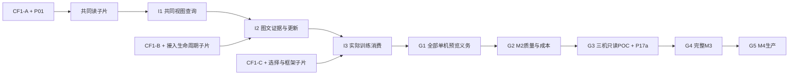

# 概要设计实施计划：分批合同、提前纵向验收与模块并行

日期：2026-10-20，v0.6评审落实。2026-10-21开始按本计划实施，P01 synthetic真值首片已通过PR与主线验收，P00 CF1-A正在最终门禁，尚未冻结或接通新运行时能力；逐包状态、owner与证据见[实施追踪](2026-10-21-delivery-progress.md)。本文替代 [2026-10-19 计划](2026-10-19-product-delivery.md)的执行分解，吸收 [A1–A6](2026-10-18-next-stage.md)义务，不替代[路线图 M0–M4](../roadmap.md)退出条件。

本次按[ADR0020](../decisions/0020-product-review-and-vertical-delivery.md)调整合同/集成顺序；P00–P20仍是责任包，G1–G5及M0–M4仍是最终门槛。I1–I3只标G1内提前真实联测点，不另立产品阶段。

设计输入：[概要设计](../design/outline-design.md)、[模块合同](../design/outline-module-contracts.md)、[运行与运维](../design/outline-runtime-and-operations.md)、[竞品证据 R01–R09](../research/2026-10-20-outline-design-evidence.md)、[产品合同](../product/product-contract.md)、[ADR 0018](../decisions/0018-outline-design-and-module-contracts.md)。所有 API/类型/状态名称须在实现前冻结，不能从设计文字推定已经可用。

## 1. 交付目标、拒绝范围与场景追溯

第一交付目标是**受控单机预览**：用户从正式入口接入文本/图像及已支持外部湖快照，在共同目录/权限/固定视图中完成 SQL 准备、混合检索证据、选样和训练导出，并可诊断/刷新/联合恢复。首个样板为企业图文知识库→带版本证据检索→同语料embedding/reranker训练和评估样本实际消费。每个所需合同冻结后可并行实现模块子片，P13从I1开始接线；不等待全部P02–P12完成才第一次集成。

后续才进入大于缓存的质量/成本收口、真实三机只读 POC、完整分布式 P0 和生产发布。仍拒绝 OLTP、跨湖业务事务、无界图、任意 PG18/codec/格式兼容、未认证云后端、绕过受控入口的托管 writer；首个 writer 仅单主机独占提交权。任何扩大范围先更新合同与负例，不在集成时临时绕开。

| 场景 / 原旅程 | 业务验收目标 | 对应竞争启示和 GuraDB 取舍 | 主工作包 |
| --- | --- | --- | --- |
| S1 接入 / J1 | 不编辑内部 PG/文件即可建库、登记对象、批接入、查询状态 | R01 Milvus 的外部湖操作闭环、R02 Lance 的对象/版本；采用共同对象与单表受控提交，不将连接器当完整产品 | P00/P02/P04/P07/P08/P11/P13 |
| S2 混合证据 / J2+J3 | SQL/HTTP、全文/向量/受限图在同一视图/权限下返回 ID/version、片段坐标和来源 | R04 Vespa 的检索/排序职责、R03 Qdrant 的一致性边界；统一计划/过滤/回表，保留精确与独立关系真值 | P01/P05/P06/P08/P10/P13/P14 |
| S3 训练复现 / J4 | 保存选择、分组split/seed、模态/标签/模型版本和pin；独立reader逐值一致 | R02 Lance 的训练/版本/按需读取；选择语义归query，格式归connectors，pin归catalog | P05/P07/P09/P10/P13/P14 |
| S4 增量生命周期 / J5 | 提交/索引就绪分开、旧视图持续合法、历史可保留和回收 | R02 索引缺口补偿与维护成本、R03 部分失败可能已应用；源与发布两种fencing独立验收 | P02/P04/P06/P07/P11/P13/P14/P16/P18 |
| S5 治理部署 / J6 | 可安装、授权、观测、扩容、恢复/升级；云能力和数据驻留明确 | R05 Weaviate 的恢复覆盖、R06 ClickHouse 的诊断、R07 PG 的备份、R08 云能力；部署模式逐个认证 | P03/P08/P12/P13/P15–P20 |

R01–R08 是官方文档研究而非性能排名；P01 必须将场景假设落实为可分发样本和固定输入。没有真实业务样本时保留“候选业务预算”，不得将 synthetic 数据写成产品 baseline。

## 2. 按纵向切片冻结 CF1-A / B / C

P00仍是公共合同唯一owner，CF1表示以下三个兼容批次的总集合。下表决定各子片的准入，不要求开工前冻结所有未来字段。基础身份、授权、固定视图、预算/取消及当前副作用的恢复语义不能留到后批。

| 批次 | 所需合同与正常/错误/故障fixture | 开放的生产子片 / 未开放范围 |
| --- | --- | --- |
| CF1-A 共同读 | Resource/SourceVersion/DataRevision/ReadView、Auth/QueryContext、固定ObjectRef及完整性模式、ReadBatch、基础IndexArtifact、查询句柄/pin/预算/取消、登记/发布幂等与CAS/fencing、错误/配置/trace | P02/P03/P04/P05/P06/P08/P10的共同读子片及P12最小安装；只允许已固定且受保护输入，未冻结的源写入/自动GC/训练消费拒绝 |
| CF1-B 接入与生命周期 | A加完整资产/片段/特征/关系、Job/Operation、SourceCommitIntent/Receipt、SourceRetention/Maintenance、TaskEnvelope、发布/retiring/GC、媒体代理、新鲜度与续期/失效合同 | P04/P06完整产物、P07/P08/P11、P10媒体回表和P12运行；包含权威源完整冻结版本重新登记实现的替换/下架，源writer仍限定append，托管原位覆盖另立合同；不能由目录CAS代替源提交权 |
| CF1-C 训练消费 | A/B加TrainingSelection、Sample/成员角色/版本、ProcessingRecipe、group/split映射、Manifest/Pin交接、采样/尾批/框架版本/并行拓扑、复现等级/恢复拒绝 | P05/P10选择、P09编码/reader/真实框架、P13训练接线；未认证shuffle/弹性拓扑/精确续读拒绝 |

每批均交付schema/编码与Rust/Python round-trip、能力协商/兼容矩阵、golden与可注入fake、真实后端验收条件、唯一owner和用户手册先行合同。字段名称只是设计名，不能由文档表格推断已发布API。

每条副作用列“成功”“明确未发生”“结果未知”及恢复判断；catalog仅有状态/授权/发布决定，query通过允许依赖编排connectors/index/cluster。common不包含PG/S3客户端或业务计划，机器DAG不变。训练和范围完整性细则见[训练合同](../product/training-contract.md)与[运行设计](../design/outline-runtime-and-operations.md)。

下一批可在前批实现期间设计，但需占用实际owner槽位并在其生产子片开始前冻结。fake仅证明module-only；真实PG/对象/源/索引与框架验收不能省略。公共字段变更由P00分配版本、评估消费者、更新golden与兼容窗口；破坏性变更先停相关集成并单独复核，不在多个分支复制语义。

## 3. 人员、环境与估算口径

假设最多 **4 个同时进行的开发包**，4 位可交叉承担 Rust/Python、目录事务、查询检索、平台/质量工作的工程师，每包一个负责人；独立复核由另一负责人承担，工作量区间包含文档、负例与复核。缺少某项技能时相应波次减并发，不以“有4个槽位”推定有4个独立专家。实际人员尚未指定。

保留下表v0.5的初始总包估算作为待重估区间；它们不是新增切片相加后的承诺，CF1-A/B/C与I1/I2/I3共享原P00/P13投入，增加的实际框架/试用义务需在对应冻结点重估。下表单位为**人周**：一人全职一周的投入，属于首次规划区间，不是工期、报价或交付承诺。CF1-A/P01首片和I1反馈后分别校准后续M2子片；P14/P15 后重估 M3/M4。未知源fencing、跨语言联编或外部权限若改变方案，须重估而不是删验收。

环境假设：每开发包有独立 worktree/venv/构建输出与独立测试 PG/S3 命名空间；共用机器时 Docker/CPU/RAM/端口有配额。最多一个受控性能测量任务占用指定基准机，其余功能测试不能污染测量；4个开发槽位不等于4套无干扰基准机。多机阶段另需3台独立主机/文件系统和授权网络/对象存储，云认证还需获准测试账户/预算；P18另需PG主备、独立WAL归档/恢复目标、故障域和PG运维技能，实际HA拓扑决定重估。没有这些资源可以开发fixture/driver，不能将对应测试标通过。

当前执行环境（2026-10-21用户指定）：**使用本机模拟云环境**。后续先用独立容器、网络、数据目录和固定镜像验证对象后端、多节点及PG HA/PITR；不创建外部付费资源。报告须标注本机模拟、故障注入位置和共享物理故障域，不能将模拟结果称为真实云认证或三台物理主机验证。原G3/G5及M3/M4中的真实部署证据仍按原条件保持待验收。

## 4. 模块工作包与可交接验收

表中描述整个责任包的最终范围；早期子片按§2所需合同和§5实物依赖推进，不能用局部完成标整个包完成。标注CF1表示该子片对应批次，P00/P01无需等全部三批完成才交付第一批。

路径是拟议落位范围，尚不存在的文件不是当前支持证明。每包启动时登记具体文件清单和禁止编辑区；共享入口/锁文件/API主文件由集成 owner 串行接线。600行上限按职责拆分，不能压缩代码规避。

### 4.1 合同与单机预览基础

| ID / 负责人技能 / 人周 | 前置输入与文件所有权 | 可交接完成物 | 正例、负例与故障完成条件 |
| --- | --- | --- | --- |
| P00 公共合同 / 架构+跨语言 / 2–3 | 概要/ADR；`modules/common/`、`crates/guradb-common/`新增合同，`api/`共同schema与用户场景索引；不实现各模块业务 | CF1-A/B/C分批版本包、common值类型/port、golden、兼容矩阵、owner表和场景先行合同 | Rust/Python round-trip；未知必需能力、int8/NULL、缺版本/预算拒绝；不允许common导入上层 |
| P01 场景真值与预算 / 质量+领域 / 2–3 | 场景分析可与P00并行；`tests/fixtures/outline/`和`tests/outline_oracles/`；不修改现有门禁阈值 | 可分发图文/片段/特征/边、冻结语言/模型/维数与数据许可；算法/人工相关性/样本组独立真值、对照方案/责任差异、质量/成本预算；分别冻结事实/向量/索引/媒体工作集 | 非同一选择/排名实现自证；缺模态、重复键、NULL、父版本/模型错；数据摘要/选择性/质量固定，明确synthetic局限 |
| P02 目录资源与绑定 / PG+身份 / 3–5 | CF1+P01；`modules/catalog/`资源/绑定子模块、`crates/guradb-catalog/`桥接；独占目录migration | 资源/schema/revision/view映射、AuthContext与原子绑定/pin、manifest登记/legacy开关 | 真实PG同dataset映射；新发布不改在途context；跨租户/撤权/缺索引/过期视图拒绝；绑定与pin/retiring竞争 |
| P03 对象读取与CloudAdapter / 存储 / 3–5 | CF1+ObjectRef fixture；`modules/storage/`、`crates/guradb-storage/`；首个认证后端 | 范围/版本/校验、合并读取、缓存、短期凭据port、请求/字节/取消计量 | 真实对象后端range/version/checksum及信任边界；整对象摘要不冒充局部校验，强完整性缺能力拒绝；缓存冷热同结果；429/超时/覆盖/消失/取消有界；ETag不当通用内容hash |
| P05 共同计划与选择 / 查询 / 4–6 | CF1+P01；`query/plan`、`query/selection`等新增子模块及Rust计划层；依赖端均可fake | 同一规范请求/计划、过滤投影、受限关联/基础聚合、精确检索/图节点和训练选择语义；provider port | SQL/HTTP规范结果对照PG/PyArrow；NULL/完整int8/类型/排序；重取latest、未授权关联、无界Graph和未支持语法拒绝 |
| P06 索引产物与候选接口 / 检索 / 3–5 | CF1+P01；`modules/index/`及对应新Rust适配；不编辑catalog/query入口 | 固定revision的BM25/ANN/typed-edge产物描述符、稳定ID映射、覆盖/模型/分片证明、候选批次port | 精确真值/recall；缺shard、旧build、删除/compaction映射、错误模型拒绝；未索引补偿所需元数据齐全；不宣布目录发布 |

P04 编号留给源适配，表示业务分组而非执行先后；P05/P06 可先在fake批次上完成模块门槛，随后必须在 P10/P13 通过真实端到端验收。

### 4.2 服务入口、源适配、生命周期与消费

| ID / 负责人技能 / 人周 | 前置输入与文件所有权 | 可交接完成物 | 正例、负例与故障完成条件 |
| --- | --- | --- | --- |
| P04 源快照与批次适配 / 湖格式 / 3–5 | CF1+P03，P01；`modules/connectors/` snapshot/reader/incremental/retention子模块、`crates/guradb-connectors/` | 固定Iceberg/manifest源的ReadBatch、字段映射、受限append变化分类、SourceRetention/Maintenance port实现及源保留/引用回执 | 真实源/独立reader互操作；固定snapshot；delete/schema/rewrite/断链按白名单处理或拒绝；源仍引用对象不得获删除证明；字节/请求取消传递 |
| P07 持久Job、Pin与GC / PG+恢复 / 4–6 | P02+CF1；`modules/catalog/jobs.py`及operation/pin/gc子模块与migration；P02交权后编辑 | durable operation/attempt、幂等指纹、结果未知对账状态、训练pin/retiring删除许可、SourceRetentionReceipt登记/校验、历史容量策略 | 重放不重复逻辑结果；进程/PG重启、终态/取消竞态；源/查询/训练pin保护、缺源证明拒绝GC；跨128个run/job真实生命周期而非扩大常量 |
| P08 公共入口与薄客户端 / 协议 / 3–5 | CF1+P02/P05模块包；gateway与client-api/CLI/MCP、公共endpoint定义；不编辑query语义 | 创建/登记/查询/作业/取消/句柄的正式有界入口；固定对象版本的受控媒体代理端点；HTTP/PG共享绑定与错误；能力发现/参考 | 真实HTTP/psql/Psycopg及薄客户端；认证/撤权/游标、参数/SQLSTATE、预算/畸形协议、媒体句柄越权/Range放大、SSRF、逐跳重定向和私网出口负例；旧alpha显式入口回归 |
| P09 训练消费适配 / 数据生态 / 3–5 | CF1-C+P04/P05选择实现+P07 pin；独占`modules/connectors/training.py`及导出/reader新子模块；不重写query选择 | Sample/成员版本与ProcessingRecipe、group/split、TrainingManifest/Parquet、pin交接；固定拓扑顺序批次及至少一种真实框架适配 | 独立reader核对导出集合唯一完整、组/近重复隔离与实际多worker/尾批轨迹；按声明策略核对重复/丢尾，D/O复现分层；缺模态/保留不足、撤权/到期/取消/重试明确；源仍引用/SourceRetentionReceipt缺失或未知时GC拒绝；未实现epoch恢复拒绝 |
| P10 按需执行与真实算子接线 / 查询+性能 / 4–6 | P03/P04/P05/P06；query provider/streaming/merge子模块与`crates/guradb-query/`执行层；不编辑P09文件 | 按需provider替代全量MemTable路径、统一候选→过滤/融合→回表、固定资产/片段版本批量及Range取字节、Arrow批次/背压/总预算、训练选择执行 | 真实源+索引固定view；被测事实/向量/索引/媒体各自工作集和缓存有证据，协调器不按全数据量持有rows；冷热同真值、recall固定；媒体摘要/版本不匹配、超预算/取消/坏批次/缺分片失败 |
| P11 受控导入、提交与刷新编排 / writer+恢复 / 4–6 | P04/P06/P07/P08/P03；connectors writer子模块、query ingest/workflow子模块；P10只编辑reader/执行子模块 | 单表批接入→源回执→revision→真实索引构建→view发布；源维护回执登记/GC编排；明确源fencing能力与同表串行/未知阻塞；正式状态查询、新鲜度/保留续期，以及受支持完整snapshot的替换/下架/标签修订 | 实源提交成功响应丢失、重复operation、旧writer/旧build晚到、发布前后崩溃；不丢已确认提交；不支持多机fencing时公开拒绝，不用目录CAS冒充 |
| P12 发行与单机观测 / 平台 / 3–5 | CF1+P03，消费CF1已冻结的metric/配置合同，不等待P08实现；独占发行脚本/配置schema/运维栈和用户部署文档；模块埋点由各包owner实现 | 可重现镜像/配置、健康与版本/能力发现、trace/metrics/audit采集、单机备份/恢复操作与脱敏告警fixture | 干净环境无开发者隐含文件；无效/泄密配置拒绝；trace串job/task/view；凭据轮换/对象故障可定位；当前部署拒绝清楚；真实P08接线在P13验证 |

P09 与 P10/P11 在同一逻辑模块的新增子目录可并行，但严禁同时修改 `service.py`、Rust `lib.rs`、公共SQL schema、锁文件或既有训练入口。这些少量接线由 P13 owner 完成；需要拆分共享热文件时先提交一个独立机械拆分并复核，再启动各分支，不能靠反复解决冲突作为松耦合方案。

### 4.3 集成、M2质量、真实多机与发布

| ID / 负责人技能 / 人周 | 前置输入与文件所有权 | 可交接完成物 | 正例、负例与故障完成条件 |
| --- | --- | --- | --- |
| P13 单机产品集成 / 集成+质量 / 3–5 | 从I1按§5消费所需子片，最终G1仍依赖P02–P12全部包及P01；唯一编辑组合根、共享API/启动入口、用户完整教程及`tests/outline_journeys/` | 分I1共同查询/I2图文证据与更新/I3真实训练消费接线，最终交付S1–S5/J1–J6受控单机预览；真实PG/对象/源/索引、SQL/HTTP/训练的统一报告；legacy迁移/恢复演练 | 干净安装→接入→证据→选择→刷新→恢复；S2实际经代理取得图像/片段字节并核对版本/摘要，验证媒体访问安全负例，不能只返URI；全成功/负例/两种fencing/pin竞争；真值一致、旧视图可用；fake不计端到端通过 |
| P14 M2质量与成本 / 检索+基准 / 4–6 | driver可在P10/P11/P09接口冻结后开发，正式测量须P13最终候选；只编辑测试driver/报告，不改产品阈值 | 算法/业务/系统三层质量，固定输入的ANN/BM25/Graph/append/框架消费并发，相关工作集冷热/超缓存、总RSS、I/O/构建/历史保留放大及价值对照报告 | recall/结果与性能同时满足预冻结预算；取消/GC/历史/故障trace；重复物化去留另有ADR/兼容证据；不降负载换绿色 |
| P15 真实跨机只读POC / 运行时 / 4–6 | P14通过+获准3台独立环境；实现可与P17a并行，真实POC/G3前P17a必须通过；`modules/cluster/` runtime子模块与专用POC driver | 受限运行时与Ballista候选的有边界比较、认证/算子/版本/预算传输、跨机分片/全局归并，ADR结论 | 三主机分别真实I/O和分片工作；无共享绝对路径；网络隔离、重复/过期attempt、worker死、取消/背压；不由三进程推导M3 |
| P16 完整M3集成 / 分布式+质量 / 5–8 | P15选型+P14+P17a；query/cluster集成根、完整并发/fault driver；集成专属窗口 | 受支持writer/同步/混合检索/Graph/训练/客户端同时运行、资源隔离/重分配、coordinator恢复，M3报告 | 三worker分担真实分片；不混view/不重复发布/不丢确认提交；worker/协调器/目录/源未知故障；明确查询失败重试边界；多机writer未认证仍拒绝 |
| P17a 最小远程身份/传输 / 平台+安全 / 2–3 | CF1+P03/P08身份/凭据合同；不依赖P15选型；独占安全传输/证书配置适配，P15通过port接入 | TLS/mTLS、worker身份/委派、短期凭据/撤权、剩余deadline传递；最低安全传输测试包 | 真实网络未授权/伪worker/重放/过期/轮换拒绝；不以loopback签名扩大远程范围；G3前与选定候选真实接线通过 |
| P17b 首云、安全治理与供应链 / 平台+安全 / 3–5 | P15候选+P17a+P03/P08；首个已选后端，独占云认证driver/治理配置/发行SBOM，模块代码由owner接入 | 一个声明部署云后端认证、RBAC/数据驻留/出口、审计保留/脱敏、依赖许可证/SBOM；不包含任意多云全部实现 | 跨租户/撤权、媒体SSRF/逐跳重定向/私网出口、旧URL/旧句柄、后端差异/区域误配拒绝；不将技术措施称合规认证；无授权首云环境保留missing；额外provider逐项独立子包暂估2–4人周，待差异审计校准 |
| P18 联合恢复与升级 / 控制面+PG运维 / 6–10 | P07/P11/P12/P15接口；独占recovery/upgrade脚本、runbook与故障fixture；catalog迁移由单owner排窗；需PG主备/WAL归档和隔离恢复环境，按拓扑重估 | 实际宣称模式的PG主备/WAL归档、主库失联/旧主fencing、指定时间点还原及PG/源/对象/pin/权限联合对账；扩容/缓存重建、滚动兼容与前向恢复 | RPO/RTO先冻结再演练；旧主晚到不能继续写、WAL缺失/归档失败可诊断；源已提交目录未发布、媒体/权限缺口、撤权补偿、旧reader/在途job/pin、不可降级阻断；托管PG能力也须实际演练 |
| P19 完整质量与长稳 / 质量+SRE / 5–8 | driver可与P16/P17b/P18并行准备；正式运行依三者候选冻结；完整performance/stability/soak driver及原始证据 | 真实并发负载、完整fault registry、长稳/容量/升级/资源成本及报告归档；planned suites逐项真实接入 | 事先固定时长/seed/质量/规模/预算；泄漏/重平衡/反复失败可诊断；missing/timeout阻断；不能复用旧commit或手填性能 |
| P20 M4发布候选 / 发布+独立复核 / 2–3 | P16/P17a/P17b/P18/P19通过，完整手册/兼容/许可证和环境合同；发行manifest/签名/晋升记录 | 绑定最终commit、镜像/配置/数据/报告摘要的release候选；已认证部署模式和恢复点 | `check --scope release`真实全绿及独立复核、安装/升级/回滚演练、远端CI对应commit；未宣称的额外云认证不阻塞当前模式发布；对外发布/部署按实际授权和环境合同执行 |

这些区间不宜直接相加后除以4得日历：合同冻结、真实集成、受控性能测量、POC选型与发布门禁存在串行依赖。实施从P00的CF1-A及P01首批真值开始，按I1/I2反馈重估后续子片。额外云后端独立排包且各自增加资源，不把完整多云矩阵设为未宣称模式发布的隐含前置。

## 5. 提前纵向验收、四槽位与最终门槛

### 5.1 G1内的三个真实检查点

| 检查点 | 必须到位的实现子片 / 负责人 | 可观察退出条件与限制 |
| --- | --- | --- |
| I1 共同视图查询 | CF1-A、P01首批；P02绑定/pin、P03固定对象读、P04固定源reader、P05过滤/投影、P06精确向量/BM25、P08登记/查询、P10读取接线；P13组合 | 真实PG/对象/源；登记已保护的固定数据及索引，通过SQL和HTTP读取同dataset/view。用同谓词核对选择集合、成员版本及不同操作的独立结果真值；新发布不改在途视图，NULL/int8/未授权/缺索引/取消负例。仅有界共同读，不证明完整接入、媒体或训练 |
| I2 图文接入、证据与更新 | I1+CF1-B；P04/P06完整适配、P07持久作业/保留、P08导入/媒体入口、P10批回表、P11受控提交/刷新、P12最小安装/诊断；P13接线 | 从正式入口创建/导入托管图文及登记受支持湖源，混合检索实际取回原文/图像并核对坐标/摘要/授权；完成完整snapshot替换/下架/标签修订、新鲜度等待/失败、未知提交对账。按已冻结语言/模型与标注测业务质量；不开放未支持源delete或DML |
| I3 样本实际消费 | I2+CF1-C；P05/P10真实选择/关联、P07训练pin、P09导出/reader/选定框架，P13接线 | 固定同语料样本成员和group/split，独立reader逐值核对，真实框架运行多worker和非整除尾批；按策略核对集合/次数/顺序，发布不漂移、缺模态/撤权/保留到期/取消负例。只声明已测D/最小O，不宣称模型结果或精确续读 |

每个检查点是主线上的可运行切片，P13在每次接线前锁定组合根窗口；不是新增长期分支或三个独立产品。I1的发布测试只使用已验证、受保护的固定版本登记/CAS，不调用尚未冻结的源writer/自动GC。I2/I3未就绪不阻止I1反馈，I1通过也不能取消后续义务。

同语义不要求SQL扫描与ANN排名列表逐项相同：共用的是资源/view/授权/谓词/类型/预算，关系结果、候选排序与近似性各有独立真值。检索命中和训练成员必须能按同身份/版本回查，不能各取latest。

### 5.2 四槽位的协作窗口

| 窗口 | 槽1 | 槽2 | 槽3 | 槽4 | 出口 |
| --- | --- | --- | --- | --- | --- |
| W0 首批合同 | P00 CF1-A | P01样板/真值/对照 | 合同复核 | 资源准备 | A与首批fixture/预算冻结 |
| W1a 共同读基础 | P02读绑定 | P03固定对象读 | P05基础计划 | P06精确检索 | 各子片交付；真实配对测试 |
| W1b 提前集成 | P04固定源读 | P08登记/查询 | P10读取接线 | P13 I1接线/复核排窗 | I1；有依赖的槽等待实物到位，不用fake验收 |
| W2 后续合同 | P00 CF1-B/C设计与评审 | P01业务/组真值补齐 | P12安装/观测基础 | I1反馈/复核 | B先冻结供I2；C按P09开工前冻结，不能绕过所需安全语义 |
| W3 图文与维护 | P07生命周期（P02交权后） | P04/P06完整接入产物串行子片 | P08导入/媒体与P10回表串行子片 | P11编排，依赖未齐时仅准备 | I2所需实现齐备；不是假定一槽能同时承担多个全职包 |
| W4 图文验收 | P13 I2组合根 | 独立证据/相关性验收 | 提交/权限/保留验收 | P12诊断与恢复 | I2，保留失败与业务反馈 |
| W5 训练与预览 | P05/P10选择/关联串行子片 | P09 reader/框架（消费真实选择后验收） | P13 I3接线/迁移排窗 | P12恢复与独立场景验收 | I3后汇总G1全部义务；P14准备按槽释放调入 |
| W6 M2收口 | P14受控测量 | 质量/价值对照复核 | 长生命周期/故障复核 | 证据/兼容审计 | G2；不足则修复重验，不以G1代替 |
| W7 多机选择 | P15只读POC | P17a传输/身份 | P18恢复准备 | P19完整driver准备 | P17a真实接线后G3，只读POC不是M3 |
| W8 多机与运维 | P16完整集成 | P17b首云/安全 | P18联合恢复/升级 | P19负载/故障联调 | G4/M3，生产子能力另有证据 |
| W9 发布候选 | P19正式长稳/性能 | P18恢复复核 | P17b供应链/安全复核 | P20候选准备 | G5/M4全门禁与独立复核后才完成 |

窗口描述最多四个并行owner，包含串行交权/集成/独立复核；不是固定周历或总工期。一人可分时承担角色，复核与实现分轮记录。公共schema归P00，入口归P08，组合根归P13；共享文件交权后才编辑，不因新增检查点允许并发写同文件。性能测量仍独占指定环境。

### 5.3 既有最终门槛保持

| 门槛 | 完成证据 |
| --- | --- |
| G1 单机产品预览 | I1/I2/I3及P02–P12全部约定范围、受限Graph/关系与SQL准备、正式入口/全部薄客户端、干净安装、诊断、备份恢复、legacy迁移/兼容/负例；真实peer取代全部stub |
| G2 M2质量 | P14最终候选：按需读取、协调器有界、各相关工作集冷热/超缓存、三层检索质量、实际训练消费/更新混合负载、跨128历史生命周期及原M2各切片完整退出证据 |
| G3 真实多机POC | P15+P17a，三独立主机/磁盘、无共享路径、真实I/O/预算/取消/错误；Ballista/受限运行时实测后ADR选型 |
| G4 完整M3 | P16+相关安全能力，原路线图的多机并发、分片/归并/训练/刷新及故障、资源隔离、恢复；未认证多机writer仍拒绝 |
| G5 M4生产 | P17b/P18/P19/P20，实际宣称部署的安全/恢复/升级/容量/长稳、完整手册/许可证与真实release/远端CI证据 |

合同设计/driver可以提前，箭头是完成条件；P17b/P18/P19仍在相应生产门阻断，不能由线性图忽略并行依赖。实际关键路径需按子片owner、资源和I1/I2测量重新计算；保留旧包估算作为参考，不将提前接线等同已证明缩短工期。

## 6. 编码并行与集成纪律

- 每个并行包使用独立 `codex/` 分支和独立 worktree，从本批次CF1-A/B/C已合入的commit/checkpoint及最新main开始；每包独立 task-start、文件归属、变更计划和证据。所有任务（含普通小片）统一按 [GitHub PR流程](../../harness/parallel-development.md) 审查、验证后合入main，不直接推送主线。
- owner表锁定共享位置：P00拥有公共合同，P02/P07分时拥有catalog迁移，P08拥有gateway/客户端，P13拥有组合根/共享接线。子包只提交自己的文件；依赖通过版本化port和fixture，不跨目录“顺便修”。
- 集成者按依赖顺序通过GitHub PR以merge commit串行合入main，并对合并前主线基点运行全部合入范围的check；每次合入产生新候选，不能只验单分支或空diff。分支证据不能自动证明合入后证据。
- 每个包包含用户手册先行合同、支持/拒绝白名单、真值/负例、适用语言/架构/functional/组件性能/故障与覆盖率门槛、独立复核。仓库既有严格适用行覆盖要求保留，不能以本计划替代。
- 两次无新证据失败停止盲试，保留日志/diff/seed和commit，定位接口假设/实现/环境/能力边界；用task-abandon交接未完成包，不把它标完成。需要恢复按harness在新目录恢复checkpoint。

模块验收报告须附输入合同版本、实现commit、fixture/数据/环境摘要、已通过/拒绝/missing项和下游可运行复现命令。fake报告醒目标为module-only；真实集成报告列实际PG/源/对象/worker部署，禁止由mock或本机路径推出生产能力。

## 7. 兼容、迁移与撤销

| 迁移对象 | 准入/实施 | 撤销/恢复及阻断条件 |
| --- | --- | --- |
| legacy manifest与PG目录 | 显式登记映射，保持历史ID；双reader差异验证，只一个发布权威；先canary绑定再切入口 | 新入口关闭恢复legacy读；新格式若旧二进制不可读则阻止盲降级，向前修复或恢复联合备份 |
| 公开接口/worker协议 | CF1能力协商和明确版本窗口；HTTP/PG类型/错误与所有客户端矩阵通过 | 旧客户端未验证就保留拒绝；滚动升级前验证新旧节点及在途task，不默认全版本兼容 |
| 索引布局/重复物化 | 固定质量/成本对照；新artifact并存，旧view/pin仍引用旧reader | 回切目录绑定要新审计操作，不能重放旧build倒退；旧产物到保留窗结束才回收 |
| 托管源提交/作业 | 源回执、operation和预期父版本对账；未知结果阻塞同表后续 | 回退代码不会撤销源提交；禁止删源已引用文件；撤销业务内容需另立受支持补偿/前向修复 |
| pin/GC/权限 | 迁移保留训练/查询/导出引用与有效期；恢复权限按最新撤权账本补偿 | 旧pin/权限信息不全时暂停GC和新受保护读取；不能因恢复了旧PG备份重新授予已撤权限 |

每个持久包在实现前明确旧reader/writer窗口、在途job/pin、备份范围和回滚限制；涉及新增持久语义的详细设计/ADR须独立审查。没有生产数据的本轮仅文档变更无迁移副作用。

## 8. 原计划映射与里程碑口径

2026-10-19 原表没有 D 编号；本轮为可追溯性将其前五项和“贯穿运维”规范化为 D1–D6，不声称原文已定义这些 ID。

| 规范域 / 原2026-10-19行 | 本轮工作包 | 原A项 / 业务场景 | 所属退出条件 |
| --- | --- | --- | --- |
| D1 共同对象 / 行1 | P00/P01/P02/P04/P11 | A0数据合同延续；S1/S2 | M2产品模型/接入合同，未测对象不标支持 |
| D2 共同目录 / 行2 | P00/P02/P07/P08/P10 | A2描述符前半、A3权限/pin；S1–S4 | M2同view/授权，legacy映射及负例 |
| D3 正式接入 / 行3 | P04/P07/P08/P11/P13 | A3 operation/对账；M2-S/M2-W；S1/S4 | M2受限同步/单表append，源/发布fencing分开 |
| D4 共同查询/证据 / 行4 | P05/P06/P08/P10/P13/P14 | A1选择、A2执行、A4质量；M2-V/M2-G；S2 | M2关系/检索/Graph各自精确/近似真值和成本 |
| D5 训练消费 / 行5 | P05/P07/P09/P10/P13/P14 | A1选择/逐值、A3保留；S3 | M2固定view训练，不推出框架epoch恢复 |
| D6 安装/诊断/恢复 / 原并行贯穿行 | P03/P08/P12/P13，P17a/P17b/P18/P20 | A3长期状态；S5 | 先受控单机预览，再按M4生产部署逐项验收 |
| 原行6规模/长期质量 | P07/P10/P14 | A2局部读取、A3跨128历史、A4冷热/质量/故障；S2–S4 | M2质量收口，不由单项结果推出完整P0 |
| 原行7多机/生产 | P15/P16/P17a/P17b/P18/P19/P20 | A5只读POC、A6完整M3；S1–S5 | M3真实分布式P0；M4完整release另门 |

M0/M1已实现的有限能力与历史证据保留；新计划不追溯替换其验收。I1–I3只提供早期纵向证据；G1是全部单机产品预览，G2才收口相应M2义务；G3仅POC，G4才判断完整M3；G5须满足M4/真实release，不由bootstrap、组件测试、覆盖率或“文档已成型”代替。本文没有承诺日期、QPS/p99或认证结论。
