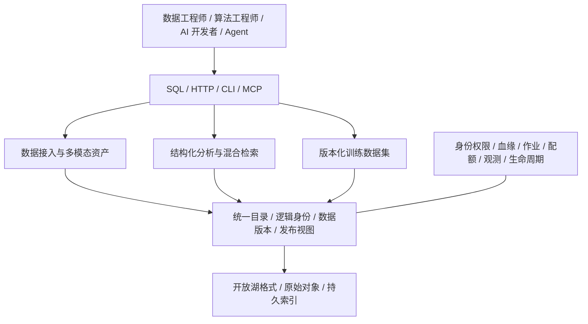

# 产品功能架构 v0.3

状态：本轮推荐的产品基线，尚未实现。日期：2026-10-17。

本版采用用户明确提出的对象存储湖架构，放弃高并发 OLTP，不支持实时延迟敏感事务；其余功能是依据[调研](../research/README.md)收敛的设计建议。技术映射见[总体架构](../architecture.md)。

## 1. 定位与服务边界

GuraDB 是面向 AI 的分布式多模态湖数据库：在对象存储和开放数据格式上，提供数据准备、版本化数据集、结构化分析及全文/向量/Graph 组合检索，统一来源、权限和快照语义。

优先服务数据与算法工程师、AI 应用开发者及调用数据库的 Agent。训练场景重视样本选择、对齐、复现和读取吞吐；推理场景提供上下文/特征检索；AI 应用场景提供多模态检索及关系证据。

本版将 RT 敏感事务解释为要求严格低延迟提交的业务事务。交互式检索仍需优化响应时间，但首版不承诺硬实时、亚毫秒或固定毫秒级事务 SLA；冷热缓存、查询复杂度与新鲜度需要分别衡量。

| 首批主要负载 | 支持方式 | 不承担的负载 |
| --- | --- | --- |
| 批量/显式小批追加、外部标注与特征导入 | 按里程碑引入外部特征、快照服务化与单表 append；持续微批和自动回填为 P1 | 大量逐行同步 INSERT/UPDATE 与立即可检索承诺 |
| 数据准备与分析 | 从固定文件投影/过滤扩展到已验收的连接、聚合、物化和导出 | 通用业务事务系统、账务/订单等关键 OLTP |
| RAG / Agent 混合检索 | 有界结果、候选预算、缓存、可解释来源 | 无预算的全图遍历或硬实时请求 |
| 训练读取 | 首先固定 revision、样本清单和 Parquet 导出，分片/预取与训练恢复按后续范围扩展 | 训练调度器、模型优化器或训练框架的 exactly-once 消费保证 |
| 推理数据服务 | 检索上下文、关联特征与媒体片段 | GPU 模型托管、token serving 与逐请求事务特征更新 |

## 2. 功能分层

功能分层不等于独立服务。每个功能通过统一目录关联数据、模型/提取器版本和派生索引，避免多个客户端分别维护数据副本。

## 3. 功能模块与优先级

P0 是多个可验收切片组成的目标集合，覆盖分布式、多种检索和湖同步；M0/M1 alpha 不等于完整 P0。P1/P2 为后续扩展。本文仅将能力域映射到里程碑；范围、依赖与退出条件统一以[路线图](../roadmap.md)为准，不能从本表推导所有能力必须同时实现。所有能力目前均未实现。

| 编号 / 模块 | P0 能力与对应里程碑 | 后续扩展 | 首要验收 |
| --- | --- | --- | --- |
| F01 目录与命名空间 | M0 最小数据集/schema/固定视图；M1 PG 持久目录、作业、pin 与发布 | 分支/标签、更多外部 catalog、跨项目共享 | 同一资源在 SQL/HTTP/CLI/MCP 中身份一致 |
| F02 湖与对象接入 | M0 固定 Parquet manifest 与 S3；M1 首个 Iceberg v2 源受限读取；M2-W 单表托管 append | 外部 Lance/WebDataset、Delta、Hudi、HF、Zarr/HDF5/LeRobot 等按需求和矩阵推进 | 删除、schema、源版本及类型不丢失，不支持特性明确拒绝 |
| F03 多模态资产 | M0 版本化对象引用；M1 外部预生成片段、媒体元数据、标签/特征与对齐关系 | 内建解码、OCR/ASR、抽帧、转码、缩略图及领域解析 | 片段可定位到准确父版本、时间/空间坐标和来源；引用不等于已具备解码能力 |
| F04 导入、湖同步与数据变更 | M1 Snapshot 服务化/共同发布；M2-S 显式 Iceberg append-only 触发增量；M2-W 托管 append | Continuous、更多源/变化子集、批式 UPDATE/DELETE/MERGE | 数据应用/索引覆盖/发布分别报告；未覆盖变更明确拒绝或显式重建，不漏读、不半发布 |
| F05 关系分析 | M0 参数化只读单表 SQL 白名单；M1 样本选择；M2-G 受限边关联；M3 已验收算子的分片执行 | 更多连接/聚合/DDL/DML、EXPLAIN、批次接口、通用分布式分析与成本优化 | 相对固定 PG 基线的结果与差异可复现；未支持算子不隐式放开 |
| F06 全文检索 | M1 预生成文本/分块的 BM25、字段过滤、固定分析器与命中证据；M3 分片合并 | 内建分块、高亮扩展、多语言/中文分析器、短语/模糊等 | 分词版本固定，权限过滤正确，索引与源快照一致 |
| F07 向量检索 | M1 模型/空间/维度/距离声明与精确基线；M2-V 内部 Lance ANN、过滤/重排；M3 全局 Top-K | 更多索引/量化、稀疏向量、多向量及重排 | 记录 recall、过滤选择性、精确回表及冷热成本 |
| F08 Graph | M2-G 稳定节点/边身份、类型/属性与有界一跳 edge join/扩展、路径证据；M3 跨分片执行 | 邻接物化、更多有界跳数/路径和批量图分析；独立图语言属 P2 | 对照关系真值；扇出/内存/时间受限，更新/删除不会残留旧边 |
| F09 混合检索 | M1 过滤 + BM25/精确向量 + RRF/确定性同分排序；M2 加入已验收 ANN/关系切片；M3 全局归并 | 查询重排、学习排序、复杂图/向量联合优化 | 各路候选与最终结果可解释，近似性与截断可见 |
| F10 训练数据集 | M1 固定视图、确定性 split/manifest 与 Parquet 导出；M3 分布式文件任务 | WebDataset/领域格式导出、去重、随机/混洗读取、框架适配与训练恢复 | 重跑保持样本身份、划分和模态对齐，保留/pin 可验证 |
| F11 处理与索引作业 | M1 外部特征、后台全文/发布恢复；M2 内部 ANN/受限图与同步作业；M3 任务重试和资源隔离 | OCR/ASR/embedding 编排，GPU/external worker 与更多邻接构建 | 所有产物绑定源版本、处理配置和模型版本；失败不污染已发布视图 |
| F12 治理与运维 | M0 身份/授权/预算/取消；M1 持久权限、追踪、基础血缘/保留；M3 资源隔离；M4 HA/升级/长稳与 release | 行列策略、细粒度成本/血缘、多集群管理 | 服务端过滤/缓存/索引/原始对象访问均在授权内；撤权不等待索引重建，发布证据完整 |

外部湖表先只读，托管写入只围绕一种权威表路径；外部读取、内部 Lance 物化、导出和原地写回分别验收。原始对象字节保真、外部片段/特征接入与内建 codec 解码也分别验收。长期覆盖所有目标格式不要求第一个 alpha 同时提供多个连接器。

湖同步是 F02/F04/F11 共同承载的一等能力，目标详见[湖加工结果同步与服务化](lake-sync-and-serving.md)。上游加工完成触发与 Continuous 常驻管道分开；同步表示不可由客户端独立写入，且同步完成必须满足配置要求的共同索引发布条件。

## 4. 核心产品对象

| 对象 | 用户看到的含义 | 必需关联 |
| --- | --- | --- |
| Dataset | 可检索、分析或导出的一组逻辑数据 | 项目、schema、来源与授权 |
| Record / Asset | 业务记录或多模态资产 | 稳定逻辑 ID、记录版本、对象身份 |
| Segment | 分块、页、帧、时间区间或空间区域 | 父资产的具体版本、坐标规则 |
| Feature | embedding、标签、转录或其它处理结果 | 输入身份/版本、模型/提取器、参数与生成作业 |
| Relation | 连接记录/资产/片段的有向关系 | 类型、源/目标身份、版本/有效性、证据 |
| Data revision | 已提交的数据集版本 | 一组精确表快照、对象与 schema 引用 |
| Read view | 可用于统一检索的已发布读取视图 | data revision + 所需索引版本，不可变 |
| Training manifest | 一个可复现训练样本集合 | read view/revision、样本 ID、模态对齐、split、生成规则 |
| Job | 导入、变换、索引、压缩或导出的执行实例 | 输入版本、配置、尝试次数、输出与发布状态 |

记录版本与存储行位置不同；压缩、重排和分片迁移不能改变业务身份。Dataset revision 不意味着所有外部源都支持同一时刻的原子快照。稳定键、重复/NULL、无键源、版本与对象引用的具体规则统一见[数据契约](data-contracts.md)，不能由各连接器/索引各自定义。

## 5. 用户流程

### 5.1 多模态检索

注册固定源版本与对象引用 → 绑定外部预生成片段/特征与标签的源列或不可变清单 → 构建本里程碑支持的索引 → 发布 read view → SQL/HTTP 执行过滤和已支持的检索/关系算子 → 返回命中证据、实际版本和受控对象访问引用。M1 不依赖托管业务 writer；首个闭环使用 BM25/精确向量，ANN 和受限 Graph 按独立切片加入，内建媒体提取属于后续能力。

默认检索使用已发布视图，结果明确披露数据版本和新鲜度。新数据已提交但索引未就绪时，状态必须可见。显式 `data_committed` 读取属于后续能力，须逐项验证等待或预算内完整扫描/补偿；尚未支持时明确拒绝，不允许静默缺候选。

### 5.2 训练数据准备

选择源 revision → 用已支持 SQL 选择样本/关联标签与模态 → 按固定规则生成样本/split → pin 所需版本 → 生成训练 manifest → Parquet 导出 → 返回样本计数、来源、处理版本与保留信息。复杂导出、混洗和训练 checkpoint 恢复不能从 manifest 能力推定。

固定随机种子不是唯一复现条件；源对象、软件/模型版本、样本排序和划分规则也需要记录。导出是产物，不是改写源湖表。

### 5.3 增量与删除

首条触发增量限定路线图中的 Iceberg append-only 子集：固定基版本与目标版本 → 校验历史链/变更类型 → 维护数据与已配置索引 → 发布新 read view → 按 pin/保留规则清理。更新、删除、rewrite、回滚等未覆盖变化明确拒绝，或按事先配置且可观察的策略 Snapshot 重建；reader 不支持的源特性不能靠重建绕过。批式修改和更多变化类型后续单独验收。

访问撤销与敏感数据删除需要作用于后续受控服务端访问；不能因为旧快照仍存在就继续向失去权限的主体提供数据。已返回字节、直连上游与外部签名 URL 的限制按[数据契约](data-contracts.md)披露，需要严格撤权的服务使用受控读取代理。物理清理是独立后台过程。

## 6. 接口与兼容范围

- SQL 以 PostgreSQL 18 的选定语法、类型和结果行为为比较基线；不宣称完整服务器或事务兼容。具体支持清单通过差异测试扩展。
- HTTP 提供发现、查询句柄、分页、取消及后续作业/发布接口。小结果使用 JSON，大结果和训练数据使用批次/对象产物。
- CLI 面向交互与自动化，提供结构化输出和稳定退出码；MCP 默认通过授权的发现/查询/状态工具服务 Agent。
- M1 以 HTTP 闭环和一个薄 CLI/MCP 适配为验收，完整二者在 M3 集成；不将所有客户端设为首个 alpha 的共同前置。
- PostgreSQL wire protocol 是 P1 兼容项目；在完成实际驱动验收前，不承诺 `psql`、ORM 或扩展二进制兼容。
- 拒绝首版不支持的事务、锁、约束与扩展行为，不通过“解析但忽略”制造虚假的 PostgreSQL 兼容。

PostgreSQL 18 是本轮选定的参考主版本，不是对未来最新版的承诺。[官方版本政策](https://www.postgresql.org/support/versioning/)。HTTP 目前仅有[查询草案](../../api/http/README.md)，作业、发布与训练 API 尚需详细设计。

## 7. 明确不纳入首版的能力

高并发 OLTP、交互式多语句业务事务、逐行低延迟提交、跨外部湖两阶段提交、强制全局唯一/外键并发约束、行锁/`SELECT FOR UPDATE`、触发器/存储过程、PostgreSQL 扩展 ABI、全量 Cypher/GQL、无界图遍历、GPU 模型 serving 与训练平台调度均不纳入首版。

批量 append、快照原子发布、权限一致性、故障恢复和并发查询仍是必要能力；批式 UPDATE/DELETE/MERGE 按后续范围设计。工作负载取舍不会取消数据正确性要求。

## 8. 验证顺序

按[路线图](../roadmap.md)逐切片执行：先固定文件精确读取，再完成首个湖 Snapshot 与精确混合检索/训练闭环；ANN、Graph、触发增量和托管 append 各自通过真值/恢复门槛；随后验收真实多 worker P0 集成及独立的生产 release。

本轮不填写缺乏工作负载依据的 QPS、p99 或 PB 级承诺。验收报告必须同时记录正确性、召回、冷热延迟、对象请求/字节、索引构建与存储放大；详细 POC 门槛见[路线图](../roadmap.md)。
