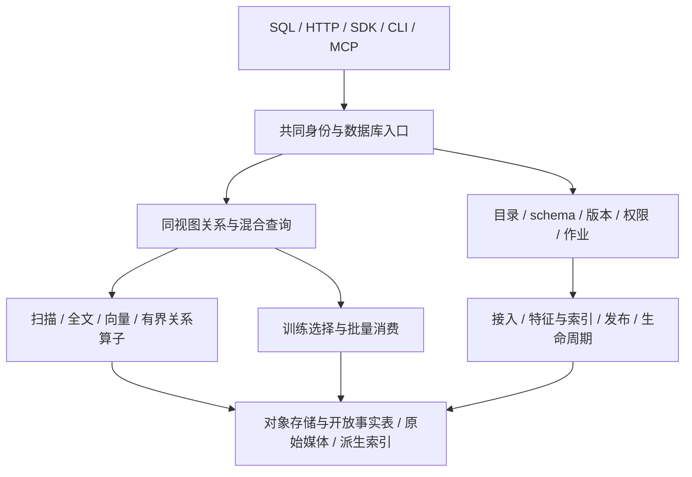

# 数据库架构与运行原理

状态：先说明产品架构目标，再列当前alpha的实际拓扑。统一目录/查询、多机资源池和高可用均未交付，不能依据目标图部署。

## 产品目标：共同管理、查询和消费数据



共同目录固定数据、schema、模型和索引版本；查询先绑定视图，再执行过滤、召回、融合、关系和回表。训练读取同一组事实与特征。对客接口共享语义，索引负责访问加速，不能接受独立事实写入。

媒体与昂贵的处理输出需要保留；索引可重建但重建/预热成本纳入恢复。交互检索、批量扫描/训练和后台构建分别管理配额，避免训练读或建索引挤占所有资源。

对象存储是持久基础，本地SSD/内存主要承载缓存；控制PG保存小型目录与状态。单机预览可合并角色，分布式部署需要真正的主机/故障域、分片/重平衡、传输和恢复合同，见[生产准备](production.md)。

## 当前alpha：两条路径仍待收敛

当前SQL与检索分别运行。这是产品架构缺口，解释了“已经发布但SQL看不到”的现象，不是长期要求用户维护的产品模型。

```text
M0：HTTP / 可选 loopback PG wire
       → 身份/白名单/预算 → 固定 Parquet manifest → Rust Arrow/DataFusion

M1/M2：HTTP ← CLI / MCP
       → 授权/固定 read view/作业与 pin → Python/PyArrow 检索、Graph、训练
       → 可选本机三个 worker（进程或 loopback HTTP，共享文件系统）
       → 托管事实副本 + BM25 / Lance ANN 派生产物

可信操作者 → snapshot / refresh / build → ready → CAS publish
固定 Iceberg v2 snapshot → 事实/媒体副本          ↕
                                  内部 PostgreSQL 控制目录
```

## 组件和部署含义

M0 用 Rust 实现 gateway/query/catalog/storage/connectors 和公共类型，DataFusion 执行受限查询；SQL 先经白名单转换，不开放引擎任意文件访问。manifest 由路径与 SHA-256 固定，启动时绑定；重启后旧句柄和游标失效。

M1/M2 的 Python 控制、构建、检索和训练路径使用内部 PostgreSQL 保存 dataset、run、发布 epoch、job、授权和 pin。PG 控制面不是 GuraDB SQL 端口。新 bundle 使用全局统计 BM25 三分片，ANN 为派生 Lance IVF_FLAT；旧 v1 有 Tantivy 路径，产物版本决定 reader 兼容性。

三个本机 worker 有独立进程/分片，可使用 loopback HTTP，但仍依赖同机绝对路径和共享文件系统；协调器仍收集记录并校验产物。此切片没有多机调度、HA 或一般分布式 exchange。

## 一致性与恢复边界

事实数据只有一个权威来源，派生索引不能独立接受业务写。逻辑 ID、record_version 与数据 revision 不依赖物理 rowid；read_view_id 将数据版本和索引版本绑定。源提交 fencing 与目录发布的 generation/epoch CAS 分别约束，旧构建不能覆盖新发布。

固定查询和训练消费必须遵循 pin；GC 不得删除当前发布或仍被 pin 的 run。M0 作为外部消费者读取 M1 manifest 时，需要操作者手动 pin，不能假定它自动使用 M1 的 job lease。

恢复需要一致的 PG 目录、完整本地事实/索引/媒体和训练产物副本。Git checkpoint 只恢复代码。未知提交先对账，索引损坏可从完整事实副本重建为新 run，事实丢失则先恢复备份。具体流程见[运维管理](operations.md)。

## 安全与演进

数据集授权在请求、执行和结果访问处复查；错误时拒绝访问。M0 与 M1 授权来源分别配置，不能互相推导。当前使用受控网络与 loopback，不内建生产 TLS/外部身份服务，也不是不可信文件或恶意多租户的硬隔离沙箱。

推荐目标栈中的 Iceberg/Parquet、Lance、Tantivy、PG 不表示所有格式或能力已接入。长期设计与演进依据见[总体设计](../architecture.md)、[数据合同](../product/data-contracts.md)和[ADR](../decisions/README.md)；实际白名单以[产品功能](features.md)及版本化契约为准。
